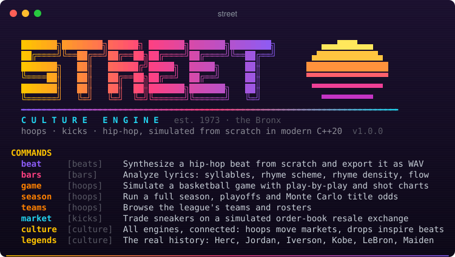
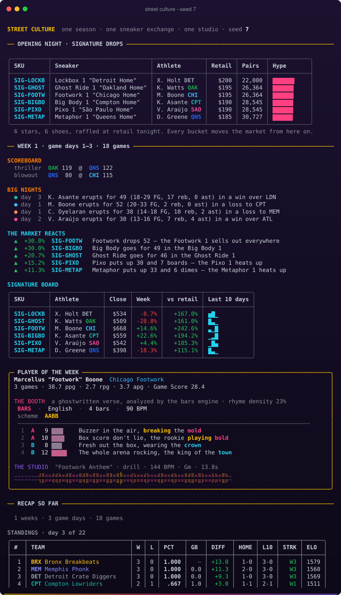
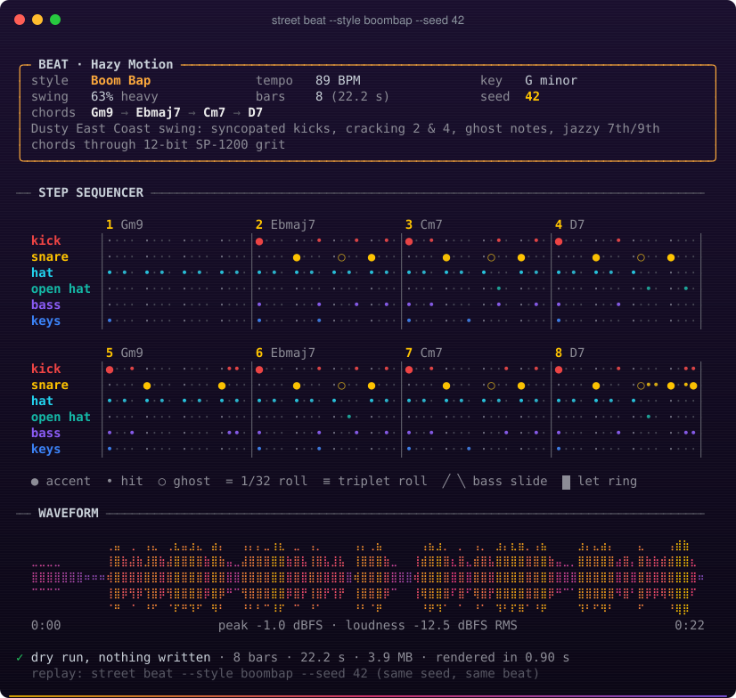
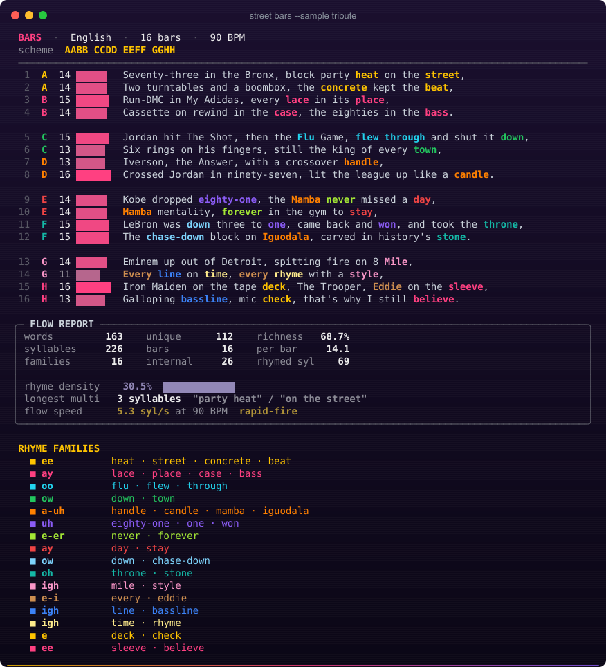
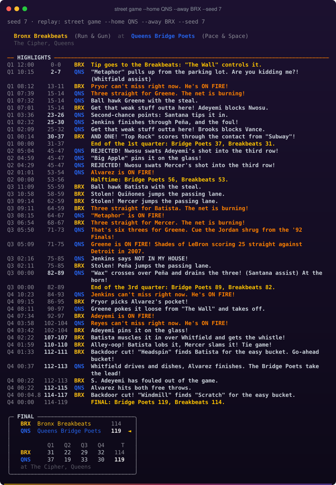
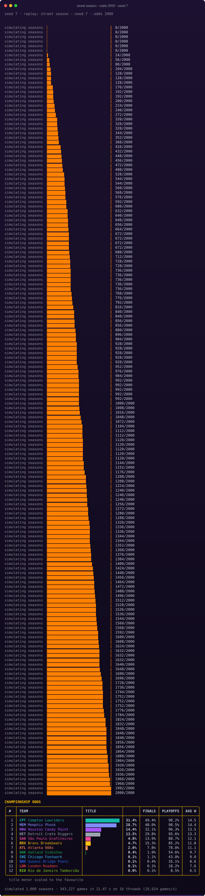
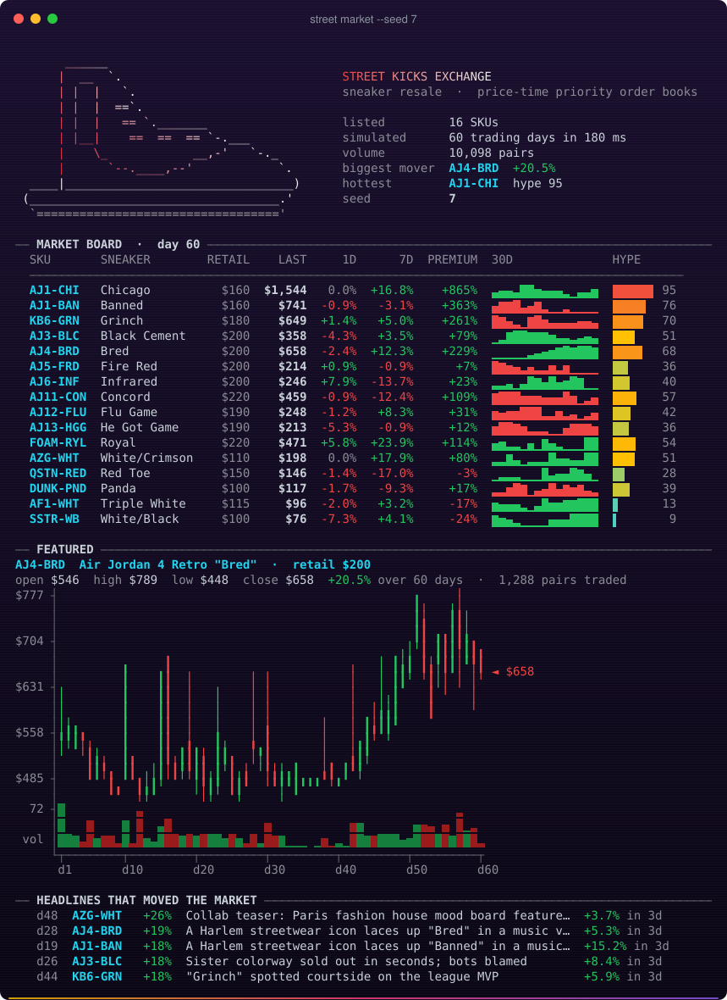
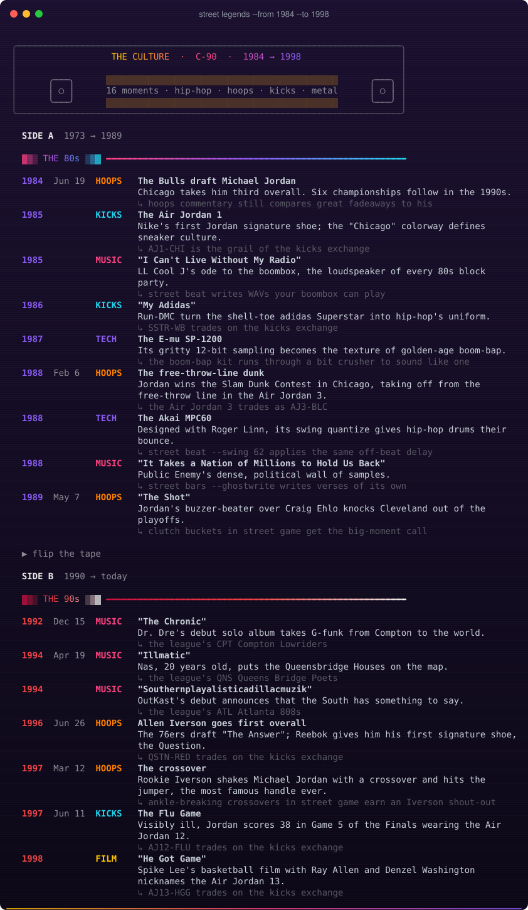
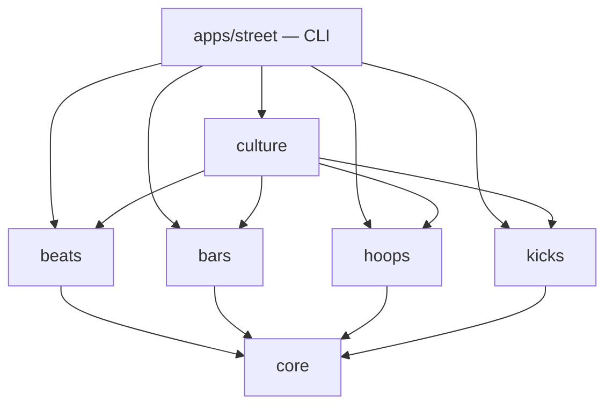

<div align="center">



### Hoops, kicks & hip-hop, simulated from scratch in modern C++20

[](https://github.com/WaynerMoraes12/street-culture-engine/actions/workflows/ci.yml)


[](LICENSE)

[English](README.md) · [Português](README.pt-BR.md)

</div>

---

> **August 11, 1973. 1520 Sedgwick Avenue, the Bronx.** DJ Kool Herc loops a drum break on
> two turntables and hip-hop is born. Twelve years later a rookie from Chicago laces up the
> Air Jordan 1. In 1986 Run-DMC write a song about their adidas. In 1997 a 6-foot rookie
> named Iverson crosses over Michael Jordan. Basketball, sneakers and hip-hop grew up on
> the same blacktop, and they have been moving each other ever since.

**Street Culture Engine** simulates all of it and lets the pieces influence each other.
A star drops 50 and their signature shoe spikes on the resale exchange. The Player of the
Week gets a ghostwritten verse, analyzed on the spot for rhyme density, and an anthem
synthesized from raw sine waves in their city's sound: boom-bap for Queens, trap for
Atlanta, drill for London, funk for Rio.

There are no audio libraries, no frameworks and no runtime dependencies. It's all standard
C++20.

```bash
street culture --seed 7 --mixtape out/   # a whole season: games → markets → verses → beats
```



## Eight commands, five engines

| Command | Engine | What you get |
|---|---|---|
| `street beat` | 🎛️ **beats** | a beat synthesized sample by sample (boom-bap, trap, lo-fi, drill, funk carioca, 80s electro, metal gallop), written to WAV |
| `street bars` | 🎤 **bars** | rap lyrics analyzed in English or Portuguese: syllables, rhyme scheme, multisyllabic rhymes, flow speed; plus a ghostwriter |
| `street game` | 🏀 **hoops** | a possession-by-possession basketball game with play-by-play, box score and an ASCII shot chart |
| `street season` | 🏀 **hoops** | 12 teams, 132 games, standings, Elo, a best-of-7 bracket; or 2,000 seasons of Monte Carlo odds |
| `street teams` | 🏀 **hoops** | a league steeped in hip-hop geography: Queens Bridge Poets, Atlanta 808s, Rio de Janeiro Tamborzão… |
| `street market` | 👟 **kicks** | a StockX-style exchange: order books, trading agents, candlesticks, and a 25M orders/s matching engine |
| `street culture` | 🌆 **culture** | everything connected through an event bus, one season at a time |
| `street legends` | 📼 **culture** | the real history on a C-90 cassette: Herc, Run-DMC, Jordan, Iverson, Kobe, LeBron, Eminem, Iron Maiden |

## 🎛️ beats: a drum machine written from first principles

Every sound is synthesized: an 808 kick (a sine with an exponential pitch drop and tanh
drive), TR-808-style hats (six detuned square oscillators), clap bursts, a two-operator FM
electric piano, gliding 808 bass, and distorted power chords for the metal gallop. RBJ
biquad filters, SP-1200-style bit crushing, MPC swing and seeded humanisation do the rest.
The result is a real 16-bit WAV.

```bash
street beat --style boombap --seed 42          # also: trap, lofi, drill, funk, electro, gallop
street beat --pattern examples/patterns/baile-tamborzao.groove
```



→ [modules/beats](modules/beats)

## 🎤 bars: a rhyme analyzer that speaks English and Portuguese

The analyzer syllabifies with rule engines (about 440 English letter-to-sound rules, and the
Portuguese diphthong and hiatus rules). It finds the stressed vowel and builds phonetic rhyme
keys, links rhyme families (perfect, slant and multisyllabic), and scores rhyme density,
vocabulary richness and flow speed at a given BPM. It also ghostwrites.

```bash
street bars --sample tribute                   # an original verse for the legends
street bars examples/lyrics/coracao_de_quadra.txt
street bars --ghostwrite "Ace" --points 51 --lang pt
```



→ [modules/bars](modules/bars)

## 🏀 hoops: basketball, one possession at a time

The engine picks usage-weighted shooters, chooses shot zones by rating and team identity,
and turns make probabilities into logistic functions of skill, defender, distance, fatigue
and clutch. Around that it models fouls, and-ones, rebounds, a rotation system, an NBA-Jam
"on fire" state, and commentary that knows its history ("shades of Iverson in '97").
Calibrated to modern NBA numbers: 112 points, 46% FG, 35.6% from three.

```bash
street game --home QNS --away BRX --seed 7
street season --odds 2000                      # multithreaded, identical on 1 or 32 threads
```




→ [modules/hoops](modules/hoops)

## 👟 kicks: the sneaker exchange

Every SKU from the AJ1 "Chicago" to the Kobe 6 "Grinch" has its own price-time-priority
order book. Levels are contiguous arrays, order ids are generation-tagged pool handles, and
cancels are O(1). Collectors, resellers, hypebeasts and market makers trade on
Ornstein–Uhlenbeck hype with news shocks. The matching engine clears
**25+ million orders per second, with a 20 ns median latency**.

```bash
street market --seed 7 --depth
street market --bench 2000000
```



→ [modules/kicks](modules/kicks)

## 📼 legends: the real story, side A and side B



→ [modules/culture](modules/culture)

## Engineering highlights

- **Reproducible everywhere.** `<random>` distributions differ between MSVC, libstdc++ and
  libc++, so every stochastic system draws from a hand-rolled **PCG32** with its own
  distributions. A `--seed` fully describes a beat, a game, a season or a market run, and
  full games print byte-identical output on MSVC and GCC.
- **Parallel yet deterministic.** Monte Carlo seasons run in fixed chunks with per-chunk RNG
  streams and merge in order, so you get the same odds on any thread count.
- **Money is an integer.** Prices are `int64` cents. Floating point never touches the
  matching engine.
- **Pure renderers.** Every chart, court and table returns a `std::string`: truecolor in a
  terminal, clean text when piped or with `NO_COLOR`. Tests assert on it directly, and the
  screenshots here are real output converted by [`tools/ansi2svg.py`](tools).
- **Decoupled by events.** The engines never include each other. `culture` wires them
  through a typed `EventBus`, so "a 50-point game moves the sneaker market" lives in exactly
  one place.
- **Quality gates.** `/W4 /permissive-` and `-Wall -Wextra -Wpedantic -Wshadow` with
  warnings as errors, doctest suites for every module, an ASan + UBSan job, and CI on GCC,
  Clang + libc++, MSVC and Apple Clang.

## Build

Requires CMake ≥ 3.21 and a C++20 compiler (GCC 13+, Clang 17+, MSVC 19.36+, Xcode 16+).

```bash
cmake --preset release && cmake --build --preset release && ctest --preset release
./build/release/apps/street/street
```

On Windows with Visual Studio 2022: `cmake --preset msvc && cmake --build --preset msvc`.
Every command has `--help`. Global flags are `--no-color`, `--color` and `--version`.

## Architecture



Every folder has its own README:
[core](modules/core) · [beats](modules/beats) · [bars](modules/bars) ·
[hoops](modules/hoops) · [kicks](modules/kicks) · [culture](modules/culture) ·
[app](apps/street) · [tools](tools) · [cmake](cmake). The full design is in
[docs/ARCHITECTURE.md](docs/ARCHITECTURE.md).

## Respect

This project is a love letter to the culture. The facts in `street legends` and the
sneaker stories are about public figures and records, written in our own words; no lyrics
are quoted anywhere. Sneaker and model names are used only to describe the simulated
catalog. The teams, players and verses are fictional and original.

Licensed under the [MIT License](LICENSE).
