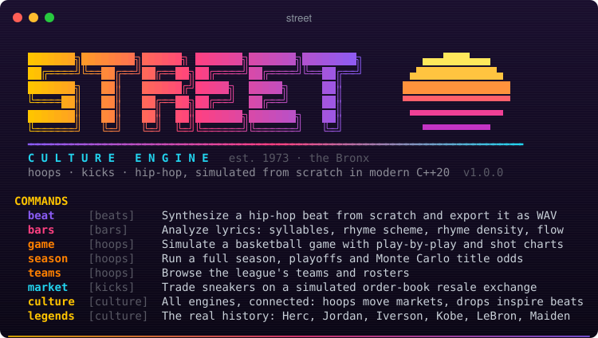
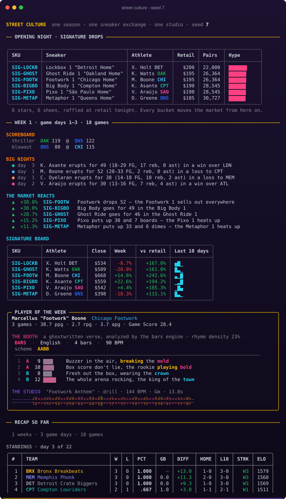
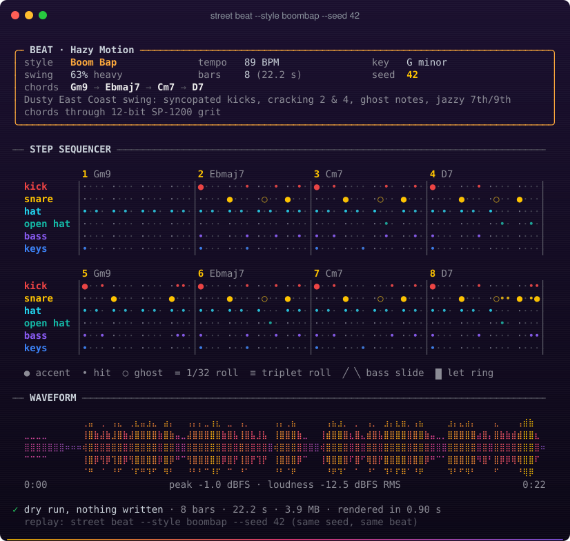
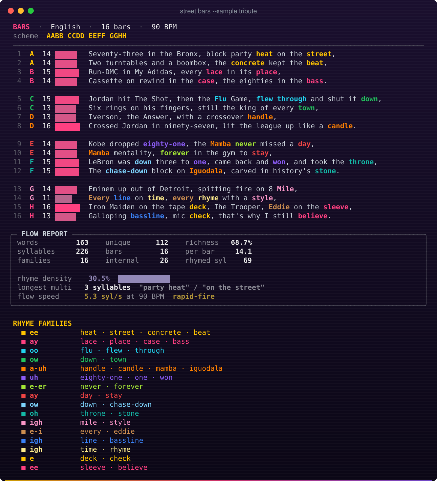
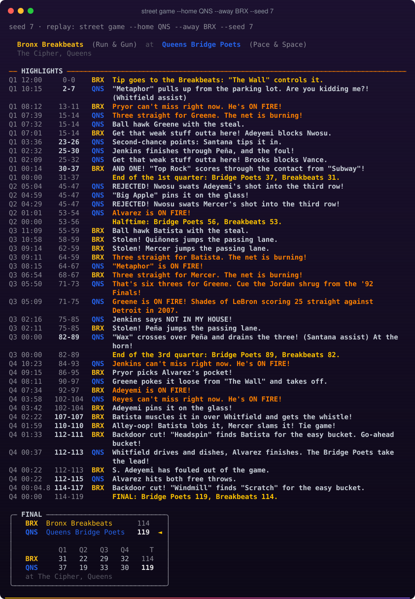
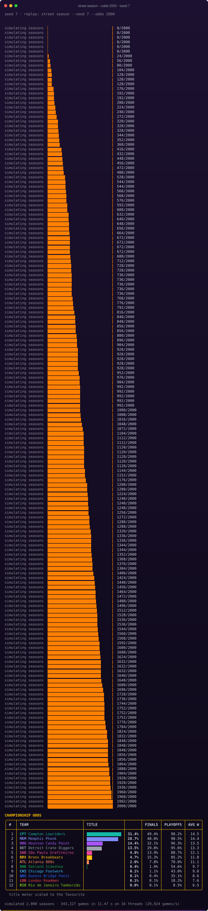
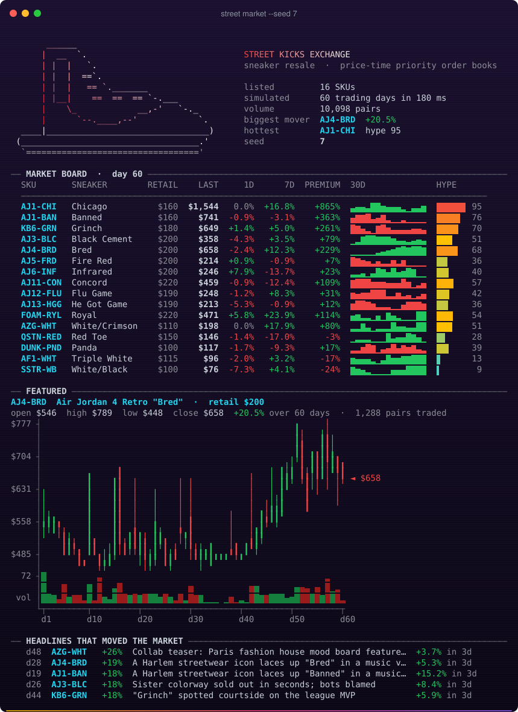
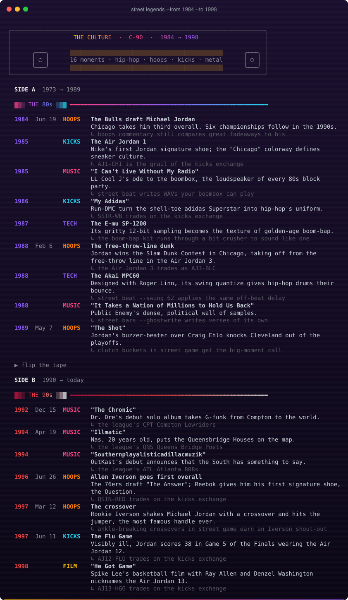
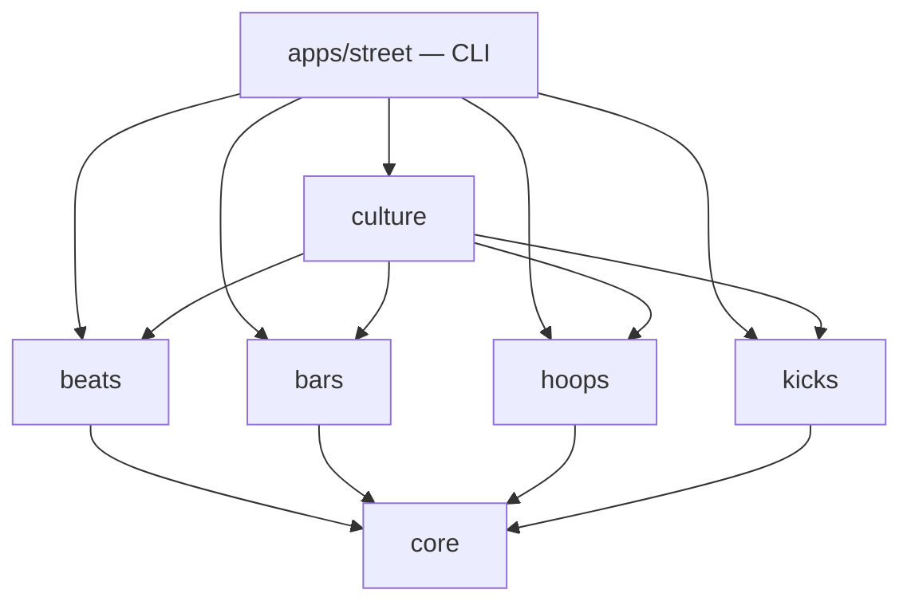

<div align="center">



### Basquete, tênis e hip-hop, simulados do zero em C++20 moderno

[](https://github.com/WaynerMoraes12/street-culture-engine/actions/workflows/ci.yml)


[](LICENSE)

[English](README.md) · [Português](README.pt-BR.md)

</div>

---

> **11 de agosto de 1973. 1520 Sedgwick Avenue, no Bronx.** DJ Kool Herc repete um break de
> bateria em dois toca-discos e o hip-hop nasce. Doze anos depois, um novato de Chicago calça o
> Air Jordan 1. Em 1986 o Run-DMC faz uma música sobre o próprio adidas. Em 1997 um novato de
> 1,83 m chamado Iverson aplica um crossover em Michael Jordan. Basquete, tênis e hip-hop
> cresceram na mesma quadra de rua, e desde então um vive mexendo no outro.

A **Street Culture Engine** simula tudo isso e deixa as peças se influenciarem. Um craque faz
50 pontos e o tênis de assinatura dele dispara na bolsa de revenda. O Jogador da Semana ganha
um verso escrito por um ghostwriter, analisado na hora pela densidade de rima, e um hino
sintetizado a partir de ondas senoidais no som da cidade dele: boom-bap para o Queens, trap
para Atlanta, drill para Londres, funk para o Rio.

Não usa biblioteca de áudio, nem framework, nem dependência em tempo de execução. É só C++20
padrão.

```bash
street culture --seed 7 --mixtape out/   # uma temporada inteira: jogos → mercado → versos → beats
```



## Oito comandos, cinco engines

| Comando | Engine | O que você ganha |
|---|---|---|
| `street beat` | 🎛️ **beats** | um beat sintetizado amostra por amostra (boom-bap, trap, lo-fi, drill, funk carioca, electro anos 80, gallop de metal), gravado em WAV |
| `street bars` | 🎤 **bars** | letras de rap analisadas em inglês ou português: sílabas, esquema de rimas, rimas multissilábicas, velocidade do flow, e um ghostwriter |
| `street game` | 🏀 **hoops** | um jogo de basquete posse a posse, com narração, box score e mapa de arremessos em ASCII |
| `street season` | 🏀 **hoops** | 12 times, 132 jogos, classificação, Elo, chave melhor-de-7; ou 2.000 temporadas de Monte Carlo |
| `street teams` | 🏀 **hoops** | uma liga com a geografia do hip-hop: Queens Bridge Poets, Atlanta 808s, Rio de Janeiro Tamborzão… |
| `street market` | 👟 **kicks** | uma bolsa estilo StockX: order books, agentes, candles e um matching engine de 25 milhões de ordens/s |
| `street culture` | 🌆 **culture** | tudo conectado por um event bus, uma temporada de cada vez |
| `street legends` | 📼 **culture** | a história real numa fita C-90: Herc, Run-DMC, Jordan, Iverson, Kobe, LeBron, Eminem, Iron Maiden |

## 🎛️ beats: uma bateria eletrônica escrita do zero

Todo som é sintetizado: o kick de 808 (senoide com queda exponencial de pitch e saturação tanh),
hi-hats estilo TR-808 (seis osciladores quadrados desafinados), palmas, um piano elétrico FM de
dois operadores, baixo 808 com glide e power chords distorcidos para o gallop de metal. Filtros
biquad RBJ, bit crusher estilo SP-1200, swing de MPC e humanização com seed fazem o resto. O
resultado é um WAV de 16 bits de verdade.

```bash
street beat --style boombap --seed 42          # também: trap, lofi, drill, funk, electro, gallop
street beat --pattern examples/patterns/baile-tamborzao.groove
```



→ [modules/beats](modules/beats)

## 🎤 bars: um analisador de rimas bilíngue

O silabador é um motor de regras (cerca de 440 regras de pronúncia do inglês, e as regras de
ditongo e hiato do português). Ele acha a vogal tônica e monta chaves fonéticas de rima, liga
famílias de rimas (perfeitas, toantes e multissilábicas) e mede densidade de rima, riqueza de
vocabulário e velocidade do flow num BPM. Também escreve versos.

```bash
street bars --sample tribute                   # um verso original para as lendas
street bars examples/lyrics/coracao_de_quadra.txt
street bars --ghostwrite "Ace" --points 51 --lang pt
```



→ [modules/bars](modules/bars)

## 🏀 hoops: basquete, uma posse de bola de cada vez

A engine escolhe arremessadores por uso, a zona do arremesso pelo rating e pela identidade do
time, e calcula a chance de cesta com uma função logística de habilidade, marcador, distância,
cansaço e decisão. Em volta disso modela faltas, and-ones, rebotes, rotação de elenco, o estado
"on fire" do NBA Jam e uma narração que conhece a história ("lembra o Iverson em 97"). Calibrada
com números da NBA atual: 112 pontos, 46% de quadra, 35,6% de três.

```bash
street game --home QNS --away BRX --seed 7
street season --odds 2000                      # multithread, idêntico com 1 ou 32 threads
```




→ [modules/hoops](modules/hoops)

## 👟 kicks: a bolsa de tênis

Todo SKU, do AJ1 "Chicago" ao Kobe 6 "Grinch", tem seu próprio order book com prioridade
preço-tempo. Os níveis são arrays contíguos, os ids de ordem são handles de pool com geração, e
o cancelamento é O(1). Colecionadores, revendedores, hypebeasts e market makers operam sobre um
hype de Ornstein–Uhlenbeck com choques de notícia. O matching engine processa **mais de 25
milhões de ordens por segundo, com latência mediana de 20 ns**.

```bash
street market --seed 7 --depth
street market --bench 2000000
```



→ [modules/kicks](modules/kicks)

## 📼 legends: a história real, lado A e lado B



→ [modules/culture](modules/culture)

## Destaques de engenharia

- **Reproduzível em qualquer lugar.** As distribuições de `<random>` mudam entre MSVC, libstdc++
  e libc++, então todo sistema aleatório usa um **PCG32** próprio, com distribuições escritas à
  mão. Um `--seed` descreve por completo um beat, um jogo, uma temporada ou um pregão, e jogos
  inteiros imprimem saída idêntica byte a byte no MSVC e no GCC.
- **Paralelo e determinístico.** O Monte Carlo roda temporadas em blocos fixos, cada um com seu
  próprio fluxo de RNG, e junta os resultados em ordem. As odds saem iguais com qualquer número
  de threads.
- **Dinheiro é inteiro.** Preços são centavos em `int64`. Ponto flutuante nunca toca o matching
  engine.
- **Renderizadores puros.** Todo gráfico, quadra e tabela devolve uma `std::string`: truecolor no
  terminal e texto limpo num pipe ou com `NO_COLOR`. Os testes verificam essa saída diretamente,
  e os screenshots daqui são saída real convertida pelo [`tools/ansi2svg.py`](tools).
- **Desacoplado por eventos.** As engines não se incluem. A `culture` liga todas por um
  `EventBus` tipado, então a regra "um jogo de 50 pontos mexe no mercado de tênis" fica num
  lugar só.
- **Barreiras de qualidade.** `/W4 /permissive-` e `-Wall -Wextra -Wpedantic -Wshadow` com
  warnings tratados como erro, suítes doctest em todo módulo, job de ASan + UBSan e CI em GCC,
  Clang + libc++, MSVC e Apple Clang.

## Compilando

Precisa de CMake ≥ 3.21 e de um compilador C++20 (GCC 13+, Clang 17+, MSVC 19.36+, Xcode 16+).

```bash
cmake --preset release && cmake --build --preset release && ctest --preset release
./build/release/apps/street/street
```

No Windows com Visual Studio 2022: `cmake --preset msvc && cmake --build --preset msvc`. Todo
comando tem `--help`. As flags globais são `--no-color`, `--color` e `--version`.

## Arquitetura



Cada pasta tem o próprio README:
[core](modules/core) · [beats](modules/beats) · [bars](modules/bars) ·
[hoops](modules/hoops) · [kicks](modules/kicks) · [culture](modules/culture) ·
[app](apps/street) · [tools](tools) · [cmake](cmake). O design completo está em
[docs/ARCHITECTURE.md](docs/ARCHITECTURE.md).

## Respeito

Este projeto é uma carta de amor à cultura. Os fatos do `street legends` e as histórias dos
tênis falam de figuras públicas e discos, escritos com nossas próprias palavras; nenhuma letra é
citada. Os nomes de tênis e modelos aparecem só para descrever o catálogo simulado. Times,
jogadores e versos são fictícios e originais.

Licença [MIT](LICENSE).
