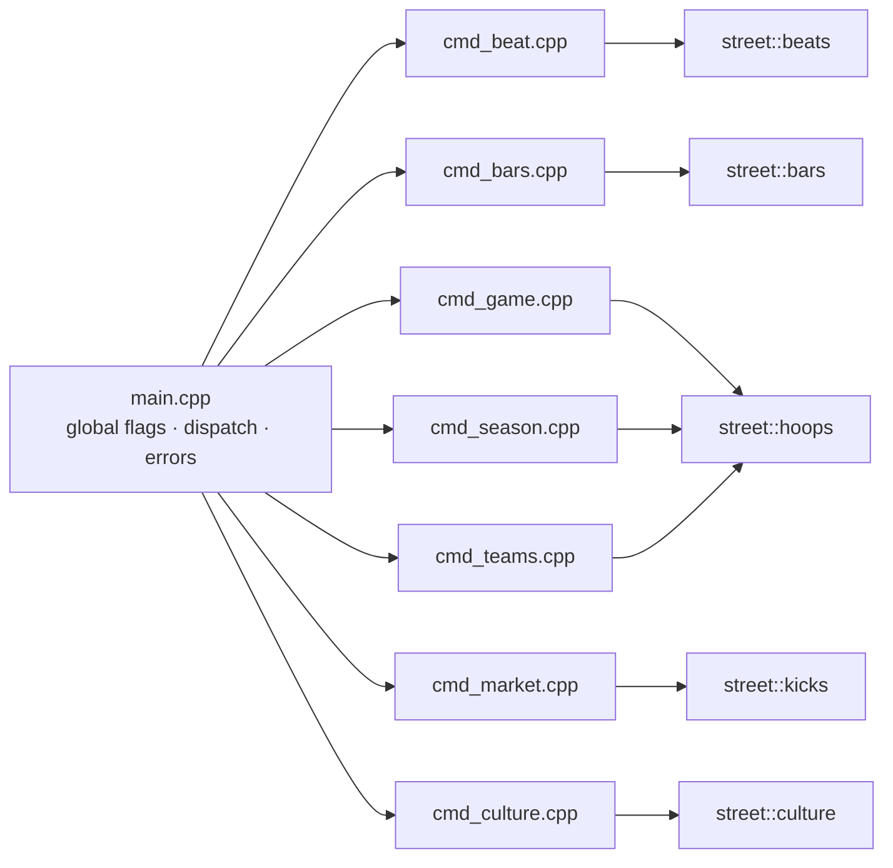

# `apps/street` — the command-line app

This is the executable that ties everything together. It is deliberately thin: it parses
arguments, calls an engine, and prints what the engine renders. All the domain logic lives
in [`modules/`](../../modules), where it can be unit-tested.



## Commands

| Command | Engine | What it does |
|---|---|---|
| `street beat` | beats | synthesizes a beat, draws the step sequencer and waveform, writes a WAV |
| `street bars` | bars | analyzes lyrics from a file, stdin or the built-in samples; lists rhymes; ghostwrites verses |
| `street game` | hoops | one game: highlights or live play-by-play, box score, shot chart |
| `street season` | hoops | a full season with standings, leaders, MVP race and playoff bracket, or Monte Carlo title odds |
| `street teams` | hoops | the league overview or one team's roster with ratings |
| `street market` | kicks | simulates the resale market: ticker, candlesticks, news, depth ladder, benchmark |
| `street culture` | culture | runs everything at once: hoops move markets, stars get verses and anthems |

Run `street` with no arguments for the banner and the command list, or
`street <command> --help` for a command's options.

## How a command is structured

Every `cmd_<name>.cpp` follows the same shape:

```cpp
int cmd_beat(Args args) {
    cli::Command cmd{"beat", "Synthesize a hip-hop beat"};
    cmd.option("style", "name", "boombap|trap|lofi|drill|funk", "boombap") /* ... */;
    const auto parsed = cmd.parse(args);          // throws cli::UsageError on bad input
    if (parsed.flag("help")) { std::cout << cmd.help(); return 0; }

    const auto beat = beats::generate(spec_from(parsed));  // engine does the work
    std::cout << beats::render_grid(beat.pattern);          // renderers return strings
    return 0;
}
```

## What `main.cpp` does

- **Global flags.** `--no-color` and `--color` are handled here and removed before
  dispatch. `NO_COLOR` and `FORCE_COLOR` are respected too.
- **Typo help.** An unknown command gets a Levenshtein-distance suggestion
  (`street sesaon` → *did you mean season?*).
- **Exit codes.** `0` means success, `1` a runtime error (I/O and similar), `2` a usage
  error (printed with a `--help` hint).
- **Banner.** [`banner.cpp`](banner.cpp) renders "ANSI Shadow" block letters with a
  truecolor gradient.

## Smoke tests

The app's `CMakeLists.txt` registers CTest cases for `--version`, the banner and the
unknown-command path. CI also runs every command end to end with fixed seeds.
