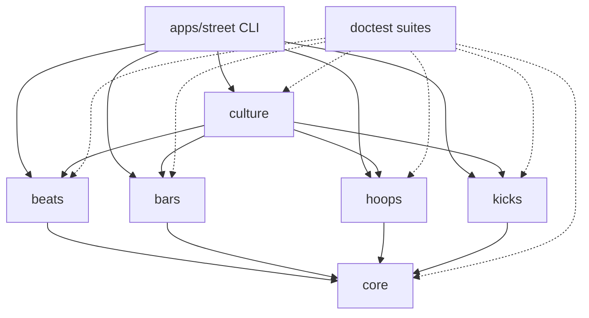
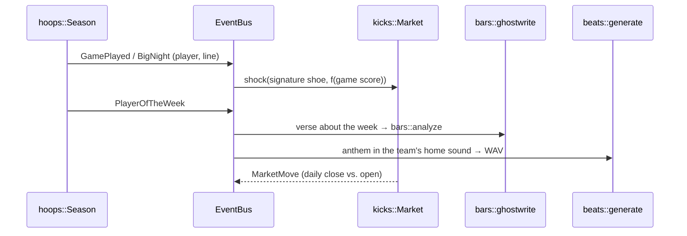

# Street Culture Engine — Architecture

> Basketball, sneakers and hip-hop grew up on the same blacktop. This engine simulates
> all three and lets them move each other.

The Street Culture Engine is a command-line simulator written in modern C++20 with **zero
runtime dependencies**. It is four independent simulation engines plus a layer that wires
them into one living world:

| Module    | Engine                                                                 | Engineering showcase                                  |
|-----------|------------------------------------------------------------------------|-------------------------------------------------------|
| `beats`   | Procedural hip-hop beat synthesizer that renders straight to WAV       | DSP from first principles, sequencing, file formats   |
| `bars`    | Lyric analyzer (EN + PT-BR): syllables, rhyme scheme, density, flow    | Phonetic heuristics, UTF-8 text processing            |
| `hoops`   | Possession-level basketball simulator, seasons, playoffs, title odds   | Stochastic modelling, multithreaded Monte Carlo       |
| `kicks`   | Sneaker resale exchange with a price-time-priority order book          | Low-latency data structures, agent-based markets      |
| `culture` | Event-driven glue: performances move markets, stars get anthems        | Decoupled architecture via a typed event bus          |

---

## 1. Repository layout

```
.
├── apps/street/          # the CLI: main.cpp dispatches to cmd_<name>.cpp
├── modules/
│   ├── core/                # shared toolkit (no domain knowledge)
│   ├── beats/  bars/  hoops/  kicks/
│   └── culture/             # depends on all four engines
├── third_party/doctest/     # vendored single-header test framework (MIT)
├── cmake/StreetHelpers.cmake    # street_add_module / street_add_tests / warnings / sanitizers
├── examples/                # sample inputs (lyrics, beat patterns, sneaker collection)
└── docs/
```

Every module has the same shape:

```
modules/<name>/
├── CMakeLists.txt           # street_add_module(<name> ...) + street_add_tests(street_<name>_tests ...)
├── include/street/<name>/*.hpp  # public API
├── src/*.cpp                # implementation
└── tests/*.cpp              # doctest suites
```

## 2. Dependency graph



Engines never include each other. Only `culture` knows that a 50-point game should move a
sneaker's price — that knowledge lives in one place and flows through `street::EventBus`.

## 3. Cross-cutting decisions

**Deterministic randomness.** `std::uniform_*_distribution` output differs between
MSVC, libstdc++ and libc++. All randomness goes through `street::Rng` (PCG32 with hand-written
distributions), so a `--seed` fully describes a beat, a game, a season or a market run.
Commands print the seed they used so any run can be reproduced.

**Parallel yet reproducible.** Monte Carlo work is split into fixed-size chunks, each with
its own `Rng` derived from `(seed, chunk index)`. Results are merged in chunk order, so the
answer is identical on 1 thread or 32.

**Money is an integer.** Prices are `std::int64_t` cents. Floating point never enters the
matching engine, so there is no rounding drift and price levels compare exactly.

**Renderers return strings.** Every visualisation (`render_*`) is a pure function that
returns text. Commands print; tests assert on output. When colors are disabled (`NO_COLOR`,
piped output, `--no-color`), the same renderers emit clean plain text.

**Thin commands.** `cmd_<name>.cpp` parses arguments with `street::cli::Command`, calls the
engine, prints the renders. Domain logic stays in the module library where it is testable.

**Errors.** Bad user input throws `street::cli::UsageError` (exit 2, with a `--help` hint).
I/O and domain failures throw standard exceptions with actionable messages (exit 1).
Programming errors (e.g. asking a parser for an undeclared option) throw `std::logic_error`.

**Quality gates.** `/W4 /permissive-` on MSVC and `-Wall -Wextra -Wpedantic -Wshadow ...`
on GCC/Clang, warnings-as-errors in CI, ASan/UBSan preset, doctest suites per module,
CI on Linux (GCC, Clang), Windows (MSVC) and macOS (Apple Clang).

## 4. `core` — shared toolkit

| Header | Purpose |
|---|---|
| `rng.hpp` | `street::Rng` (PCG32): `uniform`, `range`, `below`, `chance`, `normal`, `weighted`, `pick`, `shuffle`, `fork`; `mix64`, `hash_seed`, `random_seed` |
| `term.hpp` | truecolor styling that degrades to plain text, UTF-8 width math, `sparkline`, `meter`, `rule`, `panel`, `gradient` |
| `table.hpp` | box-drawn tables with per-column alignment (cells may be colored) |
| `cli.hpp` | declarative options/flags/positionals with auto-generated `--help` |
| `text.hpp` | trim/split/join, accent folding & case mapping for PT-BR, `money`, `thousands`, `percent`, `slug`, `read_file` |
| `stats.hpp` | mean, stddev, median, percentile, Pearson correlation, logistic |
| `event_bus.hpp` | typed synchronous pub/sub |
| `stopwatch.hpp`, `version.hpp` | timing, version string |

## 5. `beats` — procedural beat engine

Renders complete beats sample by sample, no samples or audio libraries involved.

- **Voices:** 808 kick (sine with exponential pitch drop + saturation), snare (tone +
  high-passed noise), clap (staggered noise bursts), closed/open hats (six detuned square
  oscillators, TR-808 style), 808 bass with glide, 2-operator FM electric piano for chords,
  vinyl crackle.
- **DSP:** RBJ biquad filters, one-pole smoothing, tanh saturation, bit/sample-rate
  reduction (SP-1200 grit for boom-bap), constant-power panning, peak normalisation.
- **Sequencer:** 16 steps per bar with velocities, hat rolls (1/32 and triplets), MPC-style
  swing on off-beat 16ths, seeded humanisation, fills on phrase ends.
- **Styles:** `boombap`, `trap`, `lofi`, `drill`, `funk` (Brazilian *funk carioca* /
  tamborzão), each with its own tempo, swing, key, chord language and drum grammar.
- **Pattern DSL:** hand-written grooves in a text grid (`x` accent, `o` hit, `.` rest,
  `r` roll).
- **Output:** 16-bit PCM stereo WAV; colored step-sequencer grid; waveform overview.

Public contract (additions welcome):

```cpp
namespace street::beats {
struct AudioBuffer { int sample_rate = 44100; std::vector<float> left, right;
                     std::size_t frames() const noexcept; double seconds() const noexcept; };
enum class Style { BoomBap, Trap, LoFi, Drill, Funk };
struct StyleInfo { Style style; std::string_view id, name, description;
                   int default_bpm; double default_swing; std::string_view default_key; };
std::span<const StyleInfo> styles();
const StyleInfo& info(Style style);
std::optional<Style> parse_style(std::string_view id);

struct BeatSpec { Style style = Style::BoomBap; int bpm = 0; int bars = 8; std::string key;
                  double swing = -1.0; std::uint64_t seed = 1; std::string title; };
struct Pattern;   // tracks × steps, velocities, rolls
struct Beat { BeatSpec spec; /* resolved */ Pattern pattern; std::vector<std::string> chords;
              AudioBuffer audio; };

Beat generate(const BeatSpec& spec);
Pattern parse_pattern(std::string_view text);            // throws std::invalid_argument
AudioBuffer render(const Pattern& pattern, const BeatSpec& spec);
std::vector<std::uint8_t> encode_wav(const AudioBuffer& audio);
void write_wav(const std::filesystem::path& path, const AudioBuffer& audio);
std::string render_grid(const Pattern& pattern);
std::string render_waveform(const AudioBuffer& audio, int width, int height);
}
```

CLI: `street beat [--style S] [--bpm N] [--bars N] [--key K] [--swing X] [--seed N]
[--out FILE] [--pattern FILE] [--list-styles]`

## 6. `bars` — lyric & flow analyzer

- **Language detection** (EN / PT-BR) from stop-word and orthography cues.
- **Syllabification:** English vowel-group heuristic with silent-e / -le / -ed rules;
  Portuguese rules for diphthongs and hiatus.
- **Rhyme keys:** the phonetic tail from the stressed vowel. Portuguese stress follows the
  orthographic rules (accent marks, paroxytone default for -a/-e/-o/-em/-ens endings);
  English uses normalised spelling-to-sound tails.
- **Metrics:** end-rhyme scheme letters (AABB, ABAB…), rhyme groups (including internal
  rhymes), multisyllabic rhyme length, rhyme density (rhymed syllables / total), vocabulary
  richness, syllables per bar and syllables per second at a given BPM.
- **Ghostwriter:** template + thematic rhyme lexicon verse generator used by `culture`.

```cpp
namespace street::bars {
enum class Language { Auto, English, Portuguese };
Language detect_language(std::string_view text);
int count_syllables(std::string_view word, Language lang);
std::string rhyme_key(std::string_view word, Language lang);

struct Word { std::string text; int syllables = 0; std::string key; int group = -1; };
struct Line { std::string text; std::vector<Word> words; int syllables = 0; char scheme = ' '; };
struct Analysis {
    Language language; std::vector<Line> lines; std::string scheme;
    int total_words, unique_words, total_syllables, rhyme_groups, longest_multisyllabic;
    double rhyme_density, vocabulary_richness;
    double syllables_per_second(int bpm) const;
};
Analysis analyze(std::string_view verse, Language lang = Language::Auto);
struct RenderOptions { int bpm = 90; bool show_stats = true; };
std::string render(const Analysis& analysis, const RenderOptions& options = {});
std::vector<std::string> rhymes_for(std::string_view word, Language lang, std::size_t limit = 12);

struct VerseRequest { std::string subject, team, shoe; int points = 0;
                      Language language = Language::English; std::uint64_t seed = 1; int lines = 4; };
std::string ghostwrite(const VerseRequest& request);
std::string_view sample_verse(Language lang);   // original lyrics shipped with the tool
}
```

CLI: `street bars [FILE|-] [--lang auto|en|pt] [--bpm N] [--sample en|pt]
[--rhymes WORD] [--ghostwrite NAME]`

## 7. `hoops` — basketball simulation

- **League:** 12 fictional teams steeped in hip-hop geography, 10-man rosters generated
  from archetypes (Sharpshooter, Slasher, Floor General, Rim Protector, Two-Way Wing,
  Stretch Big) with 12 ratings each. Deterministic: the league is the same on every run.
- **Game engine:** possession by possession. Pace sets possession length; usage picks the
  shooter; shot selection depends on ratings and team identity; make probability is a
  logistic function of shooter skill vs. defender, distance, fatigue and clutch time.
  Models turnovers, steals, blocks, fouls, and-ones, free throws, offensive rebounds,
  assists, fatigue and substitutions, overtime — and an *"on fire"* streak state.
- **Outputs:** play-by-play with varied commentary, box score (MIN PTS REB AST STL BLK TO
  FG 3P FT +/-), quarter-by-quarter line, Hollinger Game Score, ASCII half-court shot chart.
- **Season:** double round-robin, Elo ratings, standings, best-of-7 playoff bracket,
  MVP race.
- **Monte Carlo:** thousands of seasons across `std::thread`s with chunked, per-chunk RNG
  streams → title and playoff odds that are identical for any thread count.

```cpp
namespace street::hoops {
enum class Position { PG, SG, SF, PF, C };
struct Ratings { int inside, mid, three, free_throw, passing, handling, perimeter_d,
                 interior_d, rebounding, athleticism, stamina, clutch; int overall() const; };
struct Player { std::uint32_t id; std::string name, nickname; Position position;
                int jersey, age; std::string archetype; Ratings ratings; };
struct Team { std::uint32_t id; std::string city, name, abbrev; term::Rgb color;
              std::string identity; std::vector<Player> roster; std::string full_name() const; };
std::vector<Team> default_league();
const Team* find_team(const std::vector<Team>& league, std::string_view abbrev_or_name);

struct PlayerLine { std::uint32_t player_id; double minutes; int pts, fgm, fga, tpm, tpa,
                    ftm, fta, oreb, dreb, ast, stl, blk, tov, pf, plus_minus;
                    int reb() const; double game_score() const; };
struct Shot { std::uint32_t player_id; int side; double x, y; int value; bool made; };
struct Play { int period; double clock; int side; std::string text;
              int home_score, away_score; bool highlight; };
struct GameResult { std::uint32_t home_id, away_id; int home_score, away_score, overtimes;
                    std::array<std::vector<int>, 2> period_scores;
                    std::array<std::vector<PlayerLine>, 2> box;    // [0] home, [1] away
                    std::vector<Shot> shots; std::vector<Play> plays;
                    std::uint32_t winner_id() const; };
struct GameOptions { bool record_plays = true; bool record_shots = true; int period_minutes = 12; };
GameResult simulate_game(const Team& home, const Team& away, Rng& rng, const GameOptions& = {});

class Season {   // play_next_day(), play_regular_season(), standings(), play_playoffs(),
                 // team(id), player(id), team_of(player_id), day(), total_days() ...
};
struct TitleOdds { std::uint32_t team_id; double title_probability, playoff_probability, average_wins; };
std::vector<TitleOdds> title_odds(const std::vector<Team>& league, int seasons,
                                  std::uint64_t seed, unsigned threads = 0);

std::string render_box_score(const GameResult&, const Team& home, const Team& away);
std::string render_shot_chart(const GameResult&, int side, const Team& team);
std::string render_standings(const Season&);
std::string render_play(const Play&, const Team& home, const Team& away);
}
```

CLI: `street game [--home T] [--away T] [--seed N] [--live] [--plays all|highlights|none]
[--shot-chart home|away|both]` · `street season [--seed N] [--odds N] [--threads N]` ·
`street teams [T]`

## 8. `kicks` — sneaker resale exchange

- **Catalog:** iconic silhouettes (Air Jordan 1 "Chicago", AJ3 "Black Cement",
  AJ4 "Bred", AJ11 "Concord", …) with release year, retail price, pair count and base hype.
- **Order book:** per-SKU limit order book with price-time priority. Bids and asks are
  `std::map<Price, level>` with FIFO queues; an id index gives O(1) cancels. Limit and
  market orders, partial fills, trade tape.
- **Agents:** collectors (value buyers who hold), resellers (flip drops at a markup),
  hypebeasts (momentum/FOMO), and market makers (quote both sides around fair value).
- **Hype process:** mean-reverting (Ornstein–Uhlenbeck) hype per SKU plus shocks
  (celebrity sighting, restock rumour, a record name-drop, a 50-point game).
- **Drops:** limited pairs raffled at retail, then the secondary market opens.
- **Outputs:** ASCII candlestick chart with volume, depth ladder, ticker with premium over
  retail, matching-engine benchmark (orders/s, p50/p99 latency).

```cpp
namespace street::kicks {
using Price = std::int64_t;   // cents
using OrderId = std::uint64_t; using TraderId = std::uint32_t;
enum class Side { Buy, Sell };
struct Trade { OrderId buy_order, sell_order; TraderId buyer, seller; Price price;
               std::int32_t quantity; std::uint64_t sequence; };
struct Level { Price price; std::int64_t quantity; std::size_t orders; };
class OrderBook {  // limit(), market(), cancel(), best_bid(), best_ask(), depth(), resting_orders()
};
struct Sneaker { std::string sku, name, colorway; int year; Price retail; int pairs; double base_hype; };
const std::vector<Sneaker>& classic_catalog();
struct Candle { Price open, high, low, close; std::int64_t volume; };
struct News { int day; std::string sku, headline; double impact; };
class Market {   // Market(catalog, seed); release(sneaker); shock(sku, magnitude, headline);
                 // step_day(); day(); skus(); sneaker(sku); candles(sku); last_price(sku);
                 // hype(sku); book(sku); news()
};
struct ChartOptions { int width = 60, height = 14; std::string title; };
std::string render_candles(const std::vector<Candle>&, const ChartOptions& = {});
std::string render_depth(const OrderBook&, std::size_t levels = 8);
std::string render_ticker(const Market&);
struct BenchResult { std::size_t orders, trades; double seconds, orders_per_second, p50_ns, p99_ns; };
BenchResult benchmark(std::size_t orders, std::uint64_t seed);
}
```

CLI: `street market [--days N] [--sku SKU] [--seed N] [--catalog] [--depth] [--bench N]`

## 9. `culture` — where the engines meet

`culture` owns a `hoops::Season`, a `kicks::Market` and an `EventBus`, and runs the
season day by day:



- Each star gets a **signature sneaker** released on opening night; their performances
  push its hype.
- Every week crowns a **Player of the Week**, who gets a ghostwritten verse (analysed on
  the spot) and an anthem in their city's sound, optionally exported to a mixtape folder.
- The recap correlates each star's game scores with their shoe's daily returns.

CLI: `street culture [--seed N] [--weeks N] [--mixtape DIR] [--lang en|pt]`
