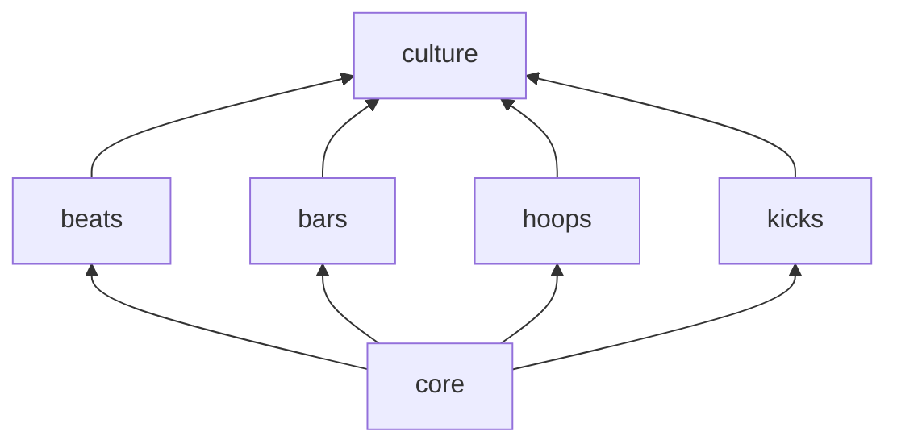

# `modules` — the engines

Each folder is a static library with the same layout: public headers in
`include/street/<name>/`, implementation in `src/`, and doctest suites in `tests/`.

| Module | Namespace | Depends on | In one line |
|---|---|---|---|
| [`core`](core) | `street`, `street::term`, `street::text`, `street::cli`, `street::stats` | — | RNG, terminal rendering, tables, CLI parsing, text, stats, event bus |
| [`beats`](beats) | `street::beats` | core | procedural hip-hop beat synthesizer → WAV |
| [`bars`](bars) | `street::bars` | core | lyric analyzer (EN + PT-BR) and ghostwriter |
| [`hoops`](hoops) | `street::hoops` | core | basketball game, season and Monte Carlo simulator |
| [`kicks`](kicks) | `street::kicks` | core | sneaker resale exchange on a limit order book |
| [`culture`](culture) | `street::culture` | all of the above | event-driven layer where the engines influence each other |



## Rules the modules follow

1. **Engines never include each other.** Only `culture` knows that a 50-point game should
   move a sneaker's price.
2. **All randomness goes through `street::Rng`,** so the same seed gives the same result.
3. **Renderers are pure functions that return `std::string`,** with color when the
   terminal supports it and plain text otherwise.
4. **Every public behaviour has a test.** Each module builds its own `street_<name>_tests`
   executable, registered with CTest.

## Adding a module

```cmake
# modules/<name>/CMakeLists.txt
street_add_module(<name> SOURCES src/<name>.cpp DEPS street::core)
street_add_tests(street_<name>_tests SOURCES tests/test_<name>.cpp LIBS street::<name>)
```

Then add `add_subdirectory(modules/<name>)` to the root `CMakeLists.txt`.
