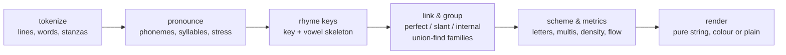

# bars — lyric & flow analyzer (English + Brazilian Portuguese)

`bars` reads a verse the way a listener hears it. It splits the verse into bars, guesses
how each word sounds, finds where the stress falls, and uses that to work out the rhyme
scheme, the rhyme families (internal rhymes included), how many syllables a multisyllabic
rhyme spans, rhyme density and delivery speed at a given BPM. There is no dictionary file
and no ML model: it is a letter-to-sound rule engine, a set of orthographic stress rules
and a small exceptions table, written in plain C++20 on top of `street::core`. It also finds
rhymes in a built-in themed lexicon and ghostwrites verses. The ghostwriter is
deterministic and its own analyzer has to agree that the lines rhyme.

```
 BARS  ·  English  ·  16 bars  ·  90 BPM
 scheme  AABB CCDD EEFF GGGG
 ────────────────────────────────────────────────────────────────────────────
  1  A   8 ███     Laced up tight for the late-night fight,
  2  A  10 ███▊    Hardwood gleaming in the stadium light,
  3  B  11 ████▏   Crossover crazy, got the ankles breaking,
  4  B  12 ████▌   Whole crowd shaking, it's a legend in the making.
 ...
 13  G  16 ██████  From the blacktop to the stage, yeah, the story's legendary,
 14  G  15 █████▋  Every verse a victory, every rhyme is necessary,
 ...
 │ rhyme density    34.9%  ██████████████                                  │
 │ longest multi   5 syllables  "story's legendary" / "is necessary"        │
 │ flow speed      4.4 syl/s at 90 BPM  steady                              │
```

In a colour terminal every rhyme family gets its own colour. The scheme letter, the end
word and any internal rhymes of that family all share it.

## Pipeline



Each word is transcribed into a compact ASCII phoneme string, one character per sound,
plus the index of every syllable nucleus and the stressed one. Everything else is derived
from that one representation:

| derived value     | definition                              | example                    |
|-------------------|-----------------------------------------|----------------------------|
| syllables         | number of nuclei                        | `crossover` → 3            |
| rhyme key         | phonemes from the stressed vowel on     | `night` → `It`             |
| vowel skeleton    | vowels of the rhyme key only            | `sneakers` → `ER`          |
| vowels()          | vowel of every syllable                 | `crossover` → `o O R`      |

Equal keys make a **perfect** rhyme (game/claim). Equal skeletons make a **slant** rhyme
(game/rain). Matching `vowels()` backwards across word boundaries gives the
**multisyllabic** length ("story's legendary" / "is necessary" = 5).

## English phonetics

- **Letter-to-sound rules** in the NRL style (Elovitz et al., 1976): each rule reads
  `left[match]right → phonemes`, with context classes for vowels, consonants, front
  vowels, sibilants and "long-vowel suffixes". About 440 rules are ordered from specific
  to general. They cover silent e (`make`, `hater`, `riding`), `-le`
  (`table` = 2), `-ed` (`played` 1, `wanted` 2), `-es` (`games` 1, `places` 2), `-tion`,
  `-ture`, `igh`, `ough`, `ph`, `ck`, `kn`, `wr`, `-mb`, and the `ow` split (flow vs. now).
- **Exceptions** (~300 entries) cover irregular spellings (`one`, `love`, `water`), lyric
  words (`gonna`, `'cause`, `ain't`), brands and acronyms (`MVP`, `NBA`). Lookups also
  reach inflected forms of an exception (`coming` ← `come`, `lovers` ← `love`).
- **Contractions and compounds**: `n't` adds a syllable after a consonant (`didn't` = 2).
  `'ll 've 'd 're 'm 's` attach to their host. `someone`, `basketball` and `overtime`
  split into known halves. `ballin'` is read as `balling` so the stem vowel comes out
  right, then the final `ng` goes back to `n`.
- **Stress for rhyming**: only the *last* stressed vowel matters. It is usually the
  final syllable unless that syllable is weak: a schwa (`-tion`, `-le`, `-ous`), or a
  final `-er`, `-y`, `-ing` or `-ic`. The heuristic steps back over at most two weak
  syllables (leg-en-**DAR**-y, cross-**O**-ver) and never lands on a schwa. Exceptions
  can mark stress explicitly (`be'gin`).
- **Key normalisation**: an r-coloured vowel right after another vowel is heard as a
  plain r, so `fire` (1 syllable) rhymes with `higher` (2) and `hour` with `power`.
- **Numbers** are read out: `50` → fifty, `1996` → nineteen ninety six.

## Portuguese phonetics (PT-BR)

Portuguese spelling is close to phonemic, so a left-to-right transcriber with context
rules is enough:

- **Diphthongs vs. hiatus**: an unaccented i/u after a vowel glides into one syllable
  (`pai`, `sou`, `muito`, `saudade`). It is a hiatus when the i/u carries an accent
  (`sa-ú-de`, `pa-ís`), comes before `nh` (`ra-i-nha`), or is closed by r/l/z/m/n
  (`sa-ir`, `ju-iz`, `ru-im`, `a-in-da`). In V+i+u the second pair wins (`sa-iu`).
  Rising sequences count apart, as school grammar does: `his-tó-ri-a` = 4.
- **Nasals**: `ão ãe õe` are nasal diphthongs. A vowel before m/n plus a consonant is
  nasal (`campo`). Final `-am`, `-em` and `-ens` become the diphthongs they sound like,
  so `falam` ends like `-ão` and `também` like `ninguém`.
- **qu/gu**: the u is silent before e/i (`quero`, `guerra`) and a glide before a/o
  (`qua-dra`, `á-gua`).
- **Consonant normalisation**: c/ç/s/ss/sc all become /s/. Intervocalic s is /z/.
  ch and x are /ʃ/. Final z is /s/, so `paz` rhymes with `atrás`. Syllable-final l turns
  into /w/ as in Brazilian speech, so `Brasil` rhymes with `partiu` and `futebol` with `gol`.
- **Stress** follows the spelling rules. An acute or circumflex accent wins, then a
  tilde. Otherwise words ending in a/e/o(+s), -am, -em or -ens are paroxytone and
  everything else is oxytone. For example `quadra` → QUA-dra, `jogador` → joga-DOR,
  `coração` → cora-ÇÃO.

## What the metrics mean

| metric                | meaning |
|-----------------------|---------|
| scheme                | End-rhyme letter per bar; stanzas separated by a space (`AABB CCDD`). Perfect end rhymes share a letter anywhere in the verse; slant end rhymes only within four bars of the same stanza. Repeated end words keep their letter. |
| rhyme families        | Connected components of the rhyme graph (union-find), end and internal rhymes together. Internal links must be within two bars; a slant internal link needs two or more matching vowels, so plain assonance doesn't count. |
| multisyllabic         | For every rhyme link, how many trailing syllables line up vowel by vowel across word boundaries. Unstressed vowels are lenient: schwa ≈ /ɪ/ /ʌ/ in English, e≈i and o≈u in Portuguese. The walk stops at repeated words (repetition is not rhyme). |
| rhyme density         | Rhymed syllables / total syllables. A syllable is "rhymed" when it is in a rhyming word's tail or inside a multisyllabic match. |
| vocabulary richness   | Unique words / total words. |
| flow speed            | Syllables per bar × BPM / 240: one line per 4/4 bar, four beats per bar. Labels: laid-back < 3, steady < 5, rapid-fire < 7, chopper ≥ 7 syl/s. |

## Ghostwriter

`ghostwrite(VerseRequest)` writes a verse from template openers with `{subject}`,
`{team}`, `{shoe}` and `{points}` slots, joined to line endings from **rhyme banks**:
14 English and 13 Portuguese families of endings whose last words rhyme perfectly.
Each couplet draws one family and two different endings (AABB). An odd line count ends
on a triplet, and there is a blank line every four bars. Families used within four bars
of each other must have different vowel skeletons, so couplets never blur into one
letter. Randomness comes only from `street::Rng` on a dedicated stream derived from the
seed, so the same request always gives the same verse. A test runs
`analyze(ghostwrite(req))` over 40 seeds × 4 lengths × 2 languages and asserts that
every couplet shares a scheme letter and a rhyme family.

`sample_verse(Sample)` returns three original 16-bar verses, all written for this
project. No real lyrics are quoted or paraphrased; names, titles and facts only.

| `Sample` | verse | what it covers |
|----------|-------|----------------|
| `English` | *Hardwood Hymn* | hoops, sneakers, the mic |
| `Portuguese` | *Coração de Quadra* | the same themes in PT-BR |
| `Tribute` | *Hall of Fame* | a roll call of legends: the Bronx block parties of '73, boomboxes and cassettes, Run-DMC's "My Adidas", Jordan's Shot and Flu Game, Iverson crossing MJ in '97, Kobe's 81 and the Mamba mentality, LeBron's 3–1 comeback and chase-down block, Eminem's Detroit and 8 Mile, Iron Maiden's Eddie and "The Trooper" |

`sample_verse(Language)` still works for the first two, and `parse_sample("tribute")`
maps CLI names to the enum. The verses are also in
[`examples/lyrics/`](../../examples/lyrics/).

## Accuracy (from the test suite)

| test set | result |
|----------|--------|
| English syllables, 80 words (rap, hoops and sneaker vocabulary plus classic traps: `fire`, `rhythm`, `business`, `idea`, `being`, `didn't`, `50`) | **80 / 80** |
| Portuguese syllables, 58 words (diphthongs, hiatus, nasals, silent u: `história`, `saúde`, `rainha`, `ruim`, `água`, `saiu`) | **58 / 58** |
| Rhyme families (game/fame/claim, flow/show/though, night/bite/height, coração/razão/pressão, quadra/enquadra, jogo/fogo, rima/clima …) and negative pairs | all pass |
| Legends and era words (`Kobe`, `LeBron`, `Iverson`, `Eminem`, `Detroit`, `Iguodala`, `Run-DMC`, `galloping`, `eighties` …) | **15 / 15** |
| Sample verses | EN `AABB CCDD EEFF GGGG`, density 35%, 5-syllable multi; PT `AABB CCDD EEBB FFGG`, density 42%, 4-syllable multi; Tribute `AABB CCDD EEFF GGHH`, density 31%, 26 internal rhymes |

The word lists were written together with the rules, so treat these numbers as
regression guards, not as a benchmark on unseen text. On free text, expect roughly 90%+
syllable accuracy for English and higher for Portuguese.

## API

```cpp
#include "street/bars/bars.hpp"
using namespace street::bars;

Analysis a = analyze(text);                       // Language::Auto detects EN / PT
std::cout << render(a, RenderOptions{.bpm = 95, .show_stats = true, .width = 100});

a.scheme;                    // "AABB CCDD"
a.rhyme_density;             // 0.349
a.longest_multisyllabic;     // 5
a.syllables_per_second(95);  // 4.7
a.lines[0].words[3].group;   // rhyme family id, -1 = none

count_syllables("legendary", Language::English);      // 4
rhyme_key("coração", Language::Portuguese);           // "Aw"
classify_rhyme("game", "rain", Language::English);    // RhymeKind::Slant
rhymes_for("game", Language::English, 12);            // fame, flame, name, ... then slant

VerseRequest req;
req.subject = "Jay"; req.team = "Uptown"; req.points = 41; req.seed = 7; req.lines = 8;
std::string verse = ghostwrite(req);                  // deterministic in req
```

Public headers: `language.hpp`, `tokenizer.hpp`, `phonetics.hpp`, `rhyme.hpp`,
`analysis.hpp`, `lexicon.hpp`, `ghostwriter.hpp`, `render.hpp`, plus the umbrella
`bars.hpp`.

## CLI

```
street bars                                   # analyze the English sample
street bars --sample pt --bpm 95              # the Portuguese sample at 95 BPM
street bars --sample tribute                  # Hall of Fame: MJ, Kobe, LeBron, AI, Em, Maiden
street bars examples/lyrics/fourth_quarter.txt
cat verse.txt | street bars - --lang en       # stdin
street bars --rhymes game                     # perfect + slant rhymes from the lexicon
street bars --rhymes trooper                  # hooper, super ... then shooter, producer
street bars --ghostwrite Jay --team Uptown --points 41 --seed 7 --lines 8
street bars --ghostwrite Jota --lang pt --lines 4
street bars --no-color --no-stats FILE        # plain annotated lyric only
```

## Tests

`street_bars_tests` has 49 doctest cases and ~6,000 assertions. It runs in under a second
and passes on MSVC, GCC and GCC with ASan/UBSan, all with warnings as errors.

| file | covers |
|------|--------|
| `test_tokenizer.cpp` | apostrophes (`don't`, `ballin'`, `'cause`), curly quotes, hyphens, UTF-8 offsets, stanzas, headers, CRLF |
| `test_language.cpp` | EN/PT detection on verses and single words, parsing, function words |
| `test_syllables.cpp` | the accuracy suites above, transcriptions, stress, edge cases, sound labels |
| `test_rhyme.cpp` | perfect families in both languages, negatives, slant, self-rhyme, multisyllabic tails |
| `test_analysis.cpp` | AABB / ABAB / stanza schemes, repetition, internal rhymes, multis, metrics, sample verses |
| `test_render.cpp` | plain output clean and ≤ width, wrapping, colours, flow labels, rhyme lists |
| `test_lexicon.cpp` | size and uniqueness, ranking (perfect before slant, multis first), PT and auto detection |
| `test_ghostwriter.cpp` | determinism, line counts, slots, the analyze-your-own-output consistency sweep |

## Files

| file | responsibility |
|------|----------------|
| `include/street/bars/language.hpp` · `src/language.cpp` | `Language`, detection from stop words + orthography, function words |
| `include/street/bars/tokenizer.hpp` · `src/tokenizer.cpp` | UTF-8 verse → lines → words with byte offsets |
| `include/street/bars/phonetics.hpp` · `src/phonetics.cpp` | `Pronunciation`, dispatch, compounds/numbers, keys, skeletons, labels |
| `src/english_rules.cpp` | NRL-style letter-to-sound rule tables and context matcher |
| `src/english.cpp` | exceptions, inflected lookups, contractions, compounds, stress heuristic |
| `src/portuguese.cpp` | PT-BR transcriber: diphthongs, hiatus, nasals, stress rules |
| `src/numbers.cpp` | numbers spelled out in English and Portuguese |
| `include/street/bars/rhyme.hpp` · `src/rhyme.cpp` | `RhymeKind`, `classify_rhyme`, lenient vowel matching |
| `include/street/bars/analysis.hpp` · `src/analysis.cpp` | rhyme linking, union-find families, scheme, multis, metrics |
| `include/street/bars/lexicon.hpp` · `src/lexicon.cpp` | ~520 EN / ~390 PT themed words (legends and eras included), ranked rhyme lookup |
| `include/street/bars/ghostwriter.hpp` · `src/ghostwriter.cpp` | templates, rhyme banks, family selection |
| `src/samples.cpp` | the three original sample verses (English, Portuguese, tribute) |
| `include/street/bars/render.hpp` · `src/render.cpp` | annotated lyric, flow report, family legend, rhyme lists |
| `apps/street/cmd_bars.cpp` | the `street bars` command |

## Limitations

- English letter-to-sound rules are heuristic. Heteronyms (`live`, `read`, `wind`) get a
  single reading, and rare or foreign words may be off by a vowel.
- There is no elision or synalepha: sung Portuguese often merges vowels across words
  (`de amor` → "d'amor"), while the counts here are grammatical.
- Vowel quality is merged where rap usually ignores it: Portuguese open and closed e/o,
  and the US English merger in carry/Mary.
- One line is assumed to be one bar. Double-time or half-time flows over a single line
  are not detected.
