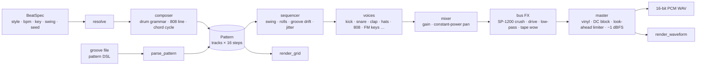

# `beats`: a procedural beat engine

`street::beats` composes and synthesises complete beats from first principles
and writes them to 16-bit stereo WAV. It uses no samples and no audio libraries:
every kick, hat, clap, 808, cowbell, cymbal, synth stab, power chord and e-piano
chord comes from oscillators, noise, envelopes and filters computed sample by sample
at 44.1 kHz. Seven styles each have their own tempo, swing, chord language, drum
grammar and sound palette: boom bap, trap, lo-fi, drill and Brazilian funk carioca,
plus two early-80s eras, TR-808 electro and an NWOBHM metal gallop. A seed fully describes a
beat, so the same `BeatSpec` renders **bit-identical audio** on a given build.
Eight bars take about 0.2–0.4 s to generate and render in Release.

```
$ street beat --style trap --seed 42
```

## How it works



1. **`resolve`** fills in anything left unset (tempo from the style's range, key
   from its key pool, a generated title), drawing from its own seeded stream.
2. **`compose`** writes the `Pattern`. It draws a small "DNA" once per seed (kick
   placements, ghost-note spots, hat grammar, 808 gestures), then writes bar after
   bar with A/B variants and seeded mutations. Bar 1 is an intro, and each 4-bar
   phrase ends with a fill or a drop-out.
3. **`render`** schedules every step as timed events, synthesises one track at a
   time into a scratch buffer, mixes it onto a drum bus or a music bus, runs the
   style's bus effects and masters the result.

Every random decision draws from an `street::Rng` (PCG32) stream derived from the
seed: tempo/key, harmony, groove, timing, humanisation, noise and vinyl each have
their own stream. So `--bpm 150` changes the tempo and leaves the drum pattern
alone.

## Voices and DSP, and why

| Piece | Technique | Why |
|---|---|---|
| **808 kick** | Sine with exponential pitch drop (≈150 → 45 Hz, τ ≈ 30–45 ms), exponential amp decay, tanh drive, 1.8 kHz beater click | The "boom" comes from the pitch sweep, not from a fixed tone. Driving the enveloped signal adds harmonics that phone speakers can reproduce, and the tail cleans up as it decays. |
| **Snare** | Two sine head modes (f, 1.6f) with a short pitch bend + high-passed white noise | The modes give the body. The noise stands in for the snare wires. |
| **Clap** | 3–4 noise bursts ~10 ms apart, then a tail, band-passed around 1.2 kHz | Several hands never hit at exactly the same moment. |
| **Hi-hats** | Six square oscillators at the TR-808's inharmonic frequencies (205.3, 304.4, 369.6, 522.7, 540, 800 Hz), band- + high-passed; free-running phases; open hat choked by the next hat | The inharmonic cluster has no clear pitch, so filtering it leaves a metallic shimmer. The choke works like the 808's shared hat circuit. |
| **808 bass** | One monophonic pass over the whole line: continuous phase, log-domain portamento for slides, re-attack from the current level, short pitch "knock", tanh drive | Continuous phase makes glides smooth and retriggers click-free. |
| **E-piano** | 2-operator FM (Chowning): `sin(ωc·t + I(t)·sin(ωm·t))`. The index decays faster than the amplitude, and velocity scales the index. Ratio 1 gives the e-piano, 3.5 a glassy bell (trap/drill) | Each note starts bright and mellows like a tine piano, and harder hits sound brighter. |
| **Rim, shaker, tom** | Resonant tone pairs, enveloped HP noise with a slow attack, pitch-bent sine (atabaque-style low tom for tamborzão) | Extra percussion for lo-fi and funk carioca. |
| **Vinyl** | Poisson crackle pops (cubed-uniform sizes: mostly ticks, the odd pop) + soft hiss, independent per channel | Lo-fi and boom-bap surface noise. |
| **808 cowbell** | Squares at 540 and 800 Hz, band-passed, two-stage decay | The metallic "clonk" of electro. |
| **Crash / ride** | The 808 metal cluster pitched up and mixed with noise, band- and high-passed, long decay; the ride adds a bell ping | Cymbals for the metal kit. |
| **Synth voice** | Two detuned PolyBLEP saws or squares, a Chamberlin state-variable low-pass with an envelope on its cutoff, ADSR amp | Electro stabs and the sequenced saw bass. For the gallop: power chords (root, fifth, octave) with short palm-mute envelopes, summed, then high-passed, hard-clipped and low-passed like a guitar cabinet. The dry take goes left and a 14 ms copy right, which fakes double-tracked guitars. |
| **Filters** | RBJ cookbook biquads (LP/HP/BP, transposed DF-II, double state), one-pole smoother, DC blocker | Standard, stable second-order sections with a Q control. |
| **Grit** | Sample-and-hold at 26.04 kHz + 12-bit quantisation on the boom-bap drum bus | Recreates the SP-1200's aliasing with no anti-alias filter. |
| **Stereo** | Constant-power pan (L = cos θ, R = sin θ), keys auto-pan | Loudness stays constant across the stereo field. |
| **Master** | DC block → loudness gain (≈ −13 dBFS RMS, at most 6 dB into the limiter) → look-ahead limiter (sliding-window minimum with a monotonic deque + moving average, O(n)) → peak normalised to −1 dBFS, raised-cosine fade | No clipping, consistent loudness, and the gain ramps down *before* each peak. |
| **Oscillators** | 2048-point sine wavetable with linear interpolation (error ≈ 1.2e-6, about −118 dB) | Several times faster than `std::sin` in the inner loops. |

**Swing (MPC style).** Within each eighth-note pair, the off-beat sixteenth moves
to `swing × pair length`, i.e. `(2·swing − 1)` steps late. `0.5` is straight and
`≈ 0.667` falls exactly on the triplet grid. **Humanisation** is split into a
shared per-step groove drift, so the whole band leans together (kick and 808
never flam), plus a small per-voice jitter and velocity spread. Lo-fi snares
also sit ~9 ms behind the beat. **Rolls** are 2 (1/32), 3 (triplet) or 4 evenly
spaced hits inside a step, crescendoing into the next hit.

## Styles

| id | Name | BPM | Swing | Feel |
|---|---|---|---|---|
| `boombap` | Boom Bap | 88–94 | 63% (heavy) | Syncopated kicks, snare on 2 & 4 with ghost notes, jazzy m7/m9 chords with rootless voicings, SP-1200 grit |
| `trap` | Trap | 130–150 | 50% | Half-time (clap + snare on 3), 1/32 and triplet hat rolls, 808 doubling the kicks and swooping up an octave, dark triads |
| `lofi` | Lo-Fi | 70–85 | 58% (lazy) | Soft drums or side-stick, late snares, strummed FM e-piano maj7/min9/m11, tape wow, low-pass, vinyl |
| `drill` | Drill | 140–145 | 52% | Hats grouped 3-3-2, snare on 3 with alternating off-beat stabs, gliding melodic 808 gestures, harmonic minor |
| `funk` | Funk Carioca | 126–134 | 55% | Tamborzão: kick and low tom trading the 3-3-2 tresillo, claps on 2 & 4, shaker on the same cells, big 808, tom roll-downs |
| `electro` | Electro 1982 | 124–132 | 50% | Early-80s Bronx electro-funk: syncopated boom kick, snare + 808 clap on 2 & 4, cowbell riff, machine-accented 16th hats, sequenced octave-jumping saw bass, off-beat saw/square stabs, 808 tom runs |
| `gallop` | Metal Gallop | 160–185 | 50% | NWOBHM tribute: the eighth-plus-two-sixteenths gallop on kick, bass and palm-muted power chords (`E5 D5 C5`), ride and crash, phrase ends that ring an open chord over a tom run or stop dead |

**The eras.** The Roland TR-808 came out in 1980, and within two years its boom kick,
cowbell and handclap had become the sound of Bronx electro-funk. `electro` is built
on that grid. `gallop` pays tribute to the New Wave of British Heavy Metal from the
same years. Its guitar is synthesised, not sampled: detuned saw/square pairs, driven
hard and rolled off like a speaker cabinet. It doesn't sound like a real guitar, but
the gallop is unmistakable.

Keys are parsed from names such as `C#m`, `F`, `Ebm`, `Bb` or `a minor` and
spelled with sharps or flats to match the key signature. Each style has minor-
and major-key chord pools.

## Pattern DSL

Write a groove by hand, one track per line:

```text
# Sunday Stoop: '#' at line start or after a space opens a comment
title   Sunday Stoop
bpm     90                  # directives are optional; command-line flags win
swing   62%                 # 0.5–0.8 or 50%–80%
key     Dm
style   boombap             # suggested kit
chords  Dm9 Gm7 | Bbmaj7 A7 # one chord per bar, cycled

kick    | x..o ..x. ..o. .... | x..o .... ..o. x..o |
snare   | .... x..g .g.. x... | .... x..g .... x.gx |
hat     | o.o. o.o. o.o. o.o. | o.o. o.o. o.o. o... |
bass    | x..o ..x. ..o. .... | x..o .... ..^. ~..o |
keys    | x... .... ..o. .... | x... ...o .... .... |
```

| Char | Meaning | Char | Meaning |
|---|---|---|---|
| `x` | accent | `r` / `R` | 1/32 roll (accented) |
| `o` | hit | `t` / `T` | triplet roll (accented) |
| `g` | ghost note | `^` | an octave up (bass: slide up into it) |
| `.` `-` `_` `·` | rest | `~` | bass: slide back to the chord root |
| | | `*` | guitar: open power chord left ringing (plain hits chug) |

- Spaces and `|` are only visual grouping.
- Tracks hold whole bars of 16 steps. Repeating a track name appends bars, and
  shorter tracks loop to the length of the longest one.
- Instruments: `kick snare clap rim cowbell hat openhat ride crash shaker tom bass
  guitar keys`, plus the aliases `bd sd cp rs cb hh oh rd cy sh lt 808 gtr ep`.
  `guitar` plays power chords on each bar's chord root.
- Errors throw `std::invalid_argument` with the line and column, e.g.
  `pattern line 7: column 12: unexpected 'q' in the hat track`.

See [`examples/patterns/`](../../examples/patterns/) for five grooves.

## API

```cpp
#include "street/beats/beats.hpp"
using namespace street::beats;

BeatSpec spec;                 // bpm 0 / empty key / swing < 0 → seeded style defaults
spec.style = Style::Drill;
spec.seed = 42;
spec.bars = 8;

Beat beat = generate(spec);    // resolve → compose → render
write_wav("drill-42.wav", beat.audio);
std::cout << render_summary(beat) << render_grid(beat.pattern)
          << render_waveform(beat.audio, 90, 5);

// Your own groove through any kit:
Pattern groove = parse_pattern(street::text::read_file("groove.txt"));
Beat mine = from_pattern(groove, {.style = Style::LoFi, .bars = 8, .seed = 7});
```

The full contract is in [`include/street/beats/beats.hpp`](include/street/beats/beats.hpp):
`styles / info / parse_style`, `resolve`, `compose`, `generate`, `from_pattern`,
`render`, `progression`, `parse_pattern`, `encode_wav / decode_wav / write_wav`,
`render_grid`, `render_waveform`, `render_summary` and `render_style_list`. The lower
layers (`dsp.hpp`, `voices.hpp`, `theory.hpp`) are public too, and each is documented
in its header.

## CLI

```text
street beat [--style S] [--bpm N] [--bars N] [--key K] [--swing X] [--seed N]
               [--out FILE] [--pattern FILE] [--list-styles] [--dry-run]

street beat --style trap --seed 42          # reproducible: the seed is always printed
street beat --style lofi --key Ebm --bars 16
street beat --style boombap --swing 66       # swing as a fraction or a percentage
street beat --pattern examples/patterns/rooftop-trap.groove --style lofi
street beat --list-styles
street beat --style funk --dry-run           # render + visualise, write nothing
street beat --style electro --seed 1982       # TR-808 electro-funk
street beat --style gallop --key F#m          # the NWOBHM gallop
```

The command prints a summary panel, the colored step grid (velocity shading,
rolls `=`/`≡`, 808 slides `╱`/`╲`, chord names over each bar), a braille waveform
with peak and RMS levels, and `✓ wrote beat-trap-42.wav · 8 bars · 14.8 s · 2.6 MB`.
Everything stays within 100 columns and degrades to plain text with `--no-color`.

## Tests

48 doctest cases, about 7,000 assertions, running in about 2 s in Release. They are
clean under MSVC `/W4 /WX` and GCC `-Wall -Wextra -Wpedantic -Werror`, and under
ASan/UBSan.

| Suite | Covers |
|---|---|
| `test_audio` | WAV header fields byte by byte, rounding/clamping, interleaving, decode round-trip, unknown chunks, I/O errors, meters |
| `test_dsp` | Wavetable accuracy, biquad responses at known frequencies, saturation/soft-clip bounds, crusher hold and quantisation, pan law, limiter ceiling, master normalisation |
| `test_theory` | Key spellings, chord symbols and aliases, 808 register, rootless voicings |
| `test_pattern` | DSL grid, directives, CRLF, aliases, slides, looping, error messages with line and column, swing timing |
| `test_beats` | Style table, `resolve` validation, progressions that transpose with the key, **bit-identical determinism**, each style's grammar over many seeds, phrase variation, audio length/level/stereo/finiteness, sample-accurate swung placement, `from_pattern`, performance |
| `test_visual` | Colored output equals plain output after stripping ANSI, row alignment, 100-column fit, glyph encoding, waveform geometry |

## Files

| File | Responsibility |
|---|---|
| `include/street/beats/beats.hpp` | Umbrella header: `BeatSpec`, `Beat`, generation, rendering and visualisation API |
| `include/street/beats/audio.hpp` · `src/audio.cpp` | `AudioBuffer`, meters, WAV encode/decode/write |
| `include/street/beats/dsp.hpp` · `src/dsp.cpp` | Wavetable sine, biquads, one-pole, DC blocker, saturator, crusher, pan law, limiter, master |
| `include/street/beats/voices.hpp` · `src/voices.cpp` | Drum voices (incl. cowbell, cymbals), 808 / saw bass line, FM keys, vinyl |
| `src/synth.cpp` | Subtractive synth voice: stabs and power chords |
| `include/street/beats/theory.hpp` · `src/theory.cpp` | Keys, note names, chord symbols, voicings |
| `include/street/beats/pattern.hpp` · `src/pattern.cpp` | `Pattern` model, groove DSL parser, swing timing |
| `include/street/beats/style.hpp` · `src/styles.cpp` | Style table (tempo ranges, swing, key pools) |
| `src/composer.cpp` | `resolve`, chord languages, titles, `compose`, `generate`, `from_pattern` |
| `src/grooves.hpp` · `src/grooves.cpp` | Drum grammar of the five hip-hop styles |
| `src/grooves_80s.cpp` | Drum grammar of `electro` and `gallop` |
| `src/groove_tools.hpp` | Shared grammar vocabulary: weighted step picks, mutations, phrase roles (intro, fills, drop-outs) |
| `src/kit.hpp` · `src/kit.cpp` | Each style's sound palette, mix, feel and bus effects |
| `src/render.cpp` | Sequencer: scheduling, voice rendering, mixing, buses, master |
| `src/visual.cpp` | Step grid, braille waveform, summary panel, style table |
| `src/streams.hpp` | Named random streams derived from the seed |
