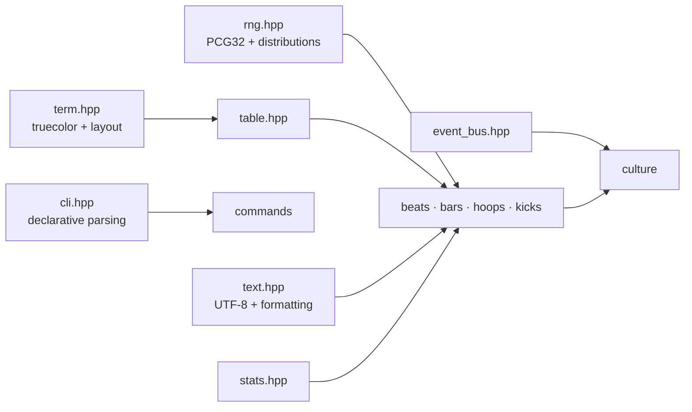

# `core` — the shared toolkit

`core` is the only module every other module depends on. It has **no domain knowledge**:
there are no players, sneakers or drums in here. What it does have is the infrastructure
that makes the engines reproducible, testable and nice to look at in a terminal.



## Components

| Header | What it gives you | Why it exists |
|---|---|---|
| [`rng.hpp`](include/street/core/rng.hpp) | `street::Rng` (PCG32) with `uniform`, `range`, `below`, `chance`, `normal`, `weighted`, `pick`, `shuffle`, `fork`; plus `mix64`, `hash_seed`, `random_seed` | `std::uniform_*_distribution` and `std::shuffle` are implementation-defined, so the same seed gives different games on MSVC, libstdc++ and libc++. Hand-written distributions keep a seed meaningful everywhere. |
| [`term.hpp`](include/street/core/term.hpp) | truecolor `paint`, `gradient`, `sparkline`, `meter`, `rule`, `panel`, and UTF-8/ANSI-aware `width`, `pad_*`, `truncate` | Renderers are written once and degrade to clean text under `NO_COLOR`, when piped, or with `--no-color`. On Windows it switches the console to UTF-8 and enables VT sequences. |
| [`table.hpp`](include/street/core/table.hpp) | box-drawn tables with per-column alignment; cells may be colored | Box scores, tickers and standings all share one layout engine. |
| [`cli.hpp`](include/street/core/cli.hpp) | `Command` with options, flags and positionals → `Parsed`; auto-generated `--help` | Every command declares its interface once and gets validation, defaults, errors and help for free. |
| [`text.hpp`](include/street/core/text.hpp) | `split`, `trim`, `join`, Latin-1-aware `to_lower`/`to_upper`/`fold_accents`, UTF-8 encode/decode, `slug`, `money`, `thousands`, `percent`, `read_file` | Portuguese lyrics need accent handling; money is integer cents and needs formatting. |
| [`stats.hpp`](include/street/core/stats.hpp) | `mean`, `stddev`, `median`, `percentile`, `pearson`, `logistic`, `clamp`, `lerp` | Shared by the simulators and the culture recap. |
| [`event_bus.hpp`](include/street/core/event_bus.hpp) | typed synchronous pub/sub keyed by `std::type_index` | Lets `culture` wire the engines together without them knowing about each other. |
| [`stopwatch.hpp`](include/street/core/stopwatch.hpp), [`version.hpp`](include/street/core/version.hpp) | timing and version string | Benchmarks and `--version`. |

## Design notes

**PCG32.** The generator is 16 bytes of state with a 64-bit LCG and a permuted 32-bit
output. `below(n)` uses Lemire's multiply-shift rejection method (unbiased, no division in
the common case). `normal()` is Box–Muller with the second value cached. `fork()` derives
a fresh `(seed, stream)` pair, which is how the Monte Carlo workers get independent,
reproducible streams.

**Colors are opt-in at runtime.** `term::init()` enables color only when stdout is a
terminal (or `FORCE_COLOR` is set). Until then, every styling call returns its input
unchanged. That's why the unit tests can compare rendered output as plain strings.

**Width is counted in code points, not bytes.** `term::width` skips ANSI escape sequences
and counts UTF-8 lead bytes, so a cell containing `"tênis"` wrapped in color codes still
measures 5 columns. The project avoids emoji (which are double-width) in terminal output.

**CLI errors are typed.** Bad input throws `cli::UsageError` (the app prints it with a
hint and exits with 2). Asking for an option that was never declared is a programming
error and throws `std::logic_error`.

## Example

```cpp
#include "street/core/cli.hpp"
#include "street/core/rng.hpp"
#include "street/core/table.hpp"

street::cli::Command cmd{"dice", "Roll some dice"};
cmd.option("seed", "N", "Random seed", "7").option("rolls", "N", "How many", "5");
const auto args = cmd.parse(tokens);

street::Rng rng(args.unsigned_integer("seed"));
street::Table table({"Roll", "Value"});
table.align_right_from(1);
for (int i = 1; i <= args.integer("rolls"); ++i)
    table.add_row({std::to_string(i), std::to_string(rng.range(1, 6))});
std::cout << table.render();
```

## Tests

[`tests/`](tests/) holds 34 doctest cases:

- RNG determinism, ranges, bias and distribution moments
- UTF-8 and accent handling
- number formatting
- ANSI-aware width math
- panel and table geometry
- CLI parsing and error paths
- statistics and the event bus

## Files

```
include/street/core/   public headers (one per component)
src/               cli.cpp · rng.cpp · stats.cpp · table.cpp · term.cpp · text.cpp
tests/             test_cli.cpp · test_rng.cpp · test_support.cpp · test_text_term.cpp
```
