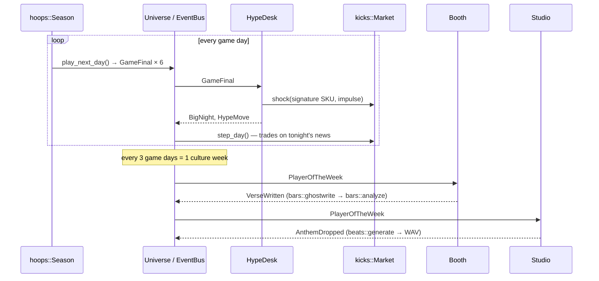

# `culture` — where the engines meet

The four engines are strangers. `hoops` has never heard of sneakers, `kicks` doesn't know
basketball exists, and `beats` and `bars` just make music and words. `culture` is the
only module that knows all of them, and it connects them the way the culture does: a star
drops 50, the resale market goes crazy, and somebody writes a song about it.

```bash
street culture --seed 7                      # a full season, week by week
street culture --weeks 3 --mixtape mixtape/  # save each anthem as a WAV
street culture --lang pt                     # verses in Brazilian Portuguese
```

## The loop



1. **Opening night.** The league's six best players each get a signature shoe
   (`design_signature`): the SKU comes from the nickname (`SIG-METAP`), the colorway from
   the team, and retail price, pair count and base hype from the player's rating. Each shoe
   is released on the exchange through a raffle at retail.
2. **Every game day.** The season plays its games, and each final is published as a
   `GameFinal`. The **HypeDesk** bridge reads the box scores: big performances become
   `BigNight` headlines, and signature athletes' games become hype shocks on their
   shoes. After that the exchange runs one trading day, so the news shows up in that
   day's candle.
3. **Every culture week** (3 game days). The best average Game Score is crowned
   **Player of the Week**. The **Booth** ghostwrites them a verse and analyzes it on the
   spot. The **Studio** synthesizes an anthem in their city's sound (`Team::sound`:
   Queens gets boom-bap, Atlanta gets trap, London gets drill, Rio gets funk…) and
   optionally writes it to the mixtape folder.
4. **Recap.** Standings, the playoff bracket and champion, the MVP race, the **Culture
   Index** and the mixtape tracklist.

## `street legends`: the real history on a cassette

The simulation is fiction, but it stands on fifty years of real moments. `legends.hpp` holds 30
of them, from DJ Kool Herc's 1973 party in the Bronx through Run-DMC's "My Adidas", Jordan's
Flu Game, Iverson's 1997 crossover, "Lose Yourself", Kobe's 81 and LeBron's block, to Iron
Maiden and the TR-808. Each one is linked to the place it lives on in the engines: a beat
style, a catalog SKU, a league team.

`render_timeline` prints them as a C-90 cassette. Side A runs 1973–1989 and side B 1990 to
today, and each decade gets a header in its era's palette: 70s funk browns and oranges, 80s
neon, 90s Bulls red.

```bash
street legends                          # the whole tape
street legends --from 1980 --to 1989    # side A, the neon decade
street legends --pillar hoops           # Jordan, Iverson, Kobe, LeBron
```

## The hype model

The market reacts to **surprise, not reputation**. A star's usual 28 points is already
priced in. What moves a shoe is the gap between tonight and what the market expected:

```
expected  = season Game Score average before tonight   (rating-based prior for the first games)
impulse   = (GameScore − expected) / 60  + 1% if won (−0.5% if lost)
          + 10% for 40+ points, +12% more for 50+, +6% for a triple-double
impulse   = clamp(impulse, −8%, +30%);   |impulse| < 3%  →  no headline, no shock
```

The impulse feeds `kicks::Market::shock`, which jumps the shoe's fair value and lets it
mean-revert through the Ornstein–Uhlenbeck hype process. Being named Player of the Week
adds another +6%.

## The Culture Index

For every signature shoe, the recap measures whether the shoe actually tracked its
athlete. It computes the **Pearson correlation between each night's Game Score and the
shoe's same-day return**, over the days the athlete played. The traders don't know the
model; they only see fair value moving. So a high *r* means the price signal made it
through the order book despite the noise from the other personas.

## Why an EventBus

Each reaction is one subscription in `Universe::Bridges`, so the whole "who influences
whom" map fits on one screen:

```cpp
u.bus_.subscribe<GameFinal>([&u](const GameFinal& e) { hype_desk(u, e); });        // hoops → kicks
u.bus_.subscribe<PlayerOfTheWeek>([&u](const PlayerOfTheWeek& e) { booth(u, e); }); // hoops → bars
u.bus_.subscribe<PlayerOfTheWeek>([&u](const PlayerOfTheWeek& e) { studio(u, e); });// hoops → beats
```

The weekly report is just another subscriber, and so is anything outside the module. The
tests count events through `universe.bus()`, and a future module could react to
`HypeMove` without touching this code.

## API

```cpp
culture::Config config;
config.seed = 7;
config.weeks = 4;                        // 0 = whole regular season
config.mixtape = "mixtape/";             // optional WAV output
culture::Universe universe(config);

universe.bus().subscribe<culture::BigNight>([](const culture::BigNight& n) { std::cout << n.headline; });
while (!universe.done()) {
    culture::WeekReport week = universe.play_week();
    std::cout << culture::render_week(week, universe);
}
culture::Recap recap = universe.finish();  // playoffs if the season is complete
```

## Tests

[`tests/test_universe.cpp`](tests/test_universe.cpp) covers:

- signature design (unique SKUs, price bounds)
- the hype model (a 50-point game spikes, a dud dips, an ordinary night is priced in)
- week mechanics
- same-seed replay determinism
- event counts observed from outside (132 regular-season finals)
- the playoff recap and correlation bounds
- WAV files landing in the mixtape folder
- renderer output with colors disabled

## Files

```
include/street/culture/events.hpp     the event types on the bus
include/street/culture/signature.hpp  signature shoe design + the hype impulse model
include/street/culture/universe.hpp   Config, WeekReport, Recap, Universe
include/street/culture/render.hpp     opening night, weekly feed, recap
include/street/culture/legends.hpp    the real-history timeline (street legends)
src/signature.cpp · src/universe.cpp · src/render.cpp · src/legends.cpp
tests/test_universe.cpp · tests/test_legends.cpp
```
