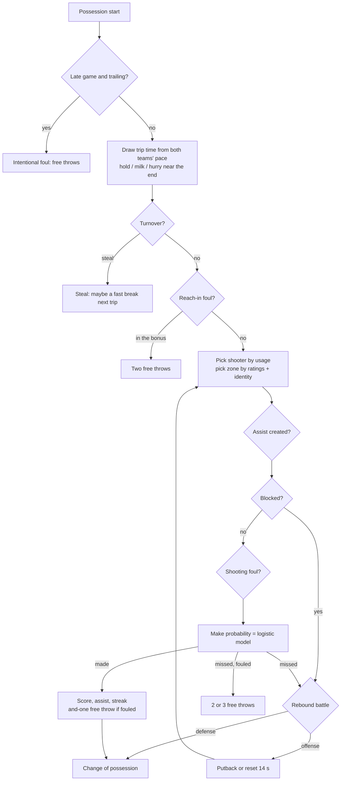
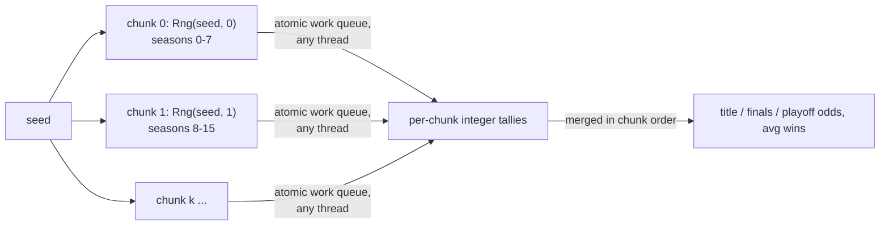

# hoops — possession-level basketball simulation

`street::hoops` plays basketball one possession at a time. Twelve fictional franchises rooted in
hip-hop geography run their own playing identities through a stochastic engine calibrated
against modern NBA box scores. It then scales up to full seasons with Elo ratings,
best-of-seven playoffs, and a multithreaded Monte Carlo that returns **bit-identical title
odds on 1 thread or 64**. The module is plain C++20 and depends only on `street::core`.

```
$ street game --home QNS --away BRX --seed 42
Q4 00:44   117-117  BRX  "The Wall" with the offensive board and the quick stick-back. Tie game!
Q4 00:01.5 119-117  BRX  Mercer hits both free throws.
Q4 00:00   119-117  QNS  Desperation heave by Reyes falls short.
```

---

## How a possession is simulated



Each possession starts with clock management. When the shot clock is off, teams hold for
the last shot. Leaders milk the clock, trailing teams hurry, and down 1–8 late they foul on
purpose. Down 3, they hunt a three. A possession that starts with under two seconds left is
a desperation heave.

## The probability model

Every make probability is a logistic function of additive **logit shifts**:

```
p(make) = 1 / (1 + e^-L)

L = base[zone]                              rim +0.54 · mid -0.40 · three -0.80
  + shooter skill   - defender skill        e.g. 0.017·(three-70) - 0.8·0.010·(perD-70)
  - distance penalty                        rim -0.10/ft, mid -0.02/ft, deep three -0.10/ft
  + spacing - paint packing                 (rim/mid only, see below)
  - 0.70·(1 - energy)                       fatigue
  + clutch                                  0.010·(clutch-70), last 5:00 within 5 points
  + home edge (0.06) + on-fire (0.22) + assisted (0.12) + fast break (0.35)
  - late shot clock (0.25) - fouled on the shot (1.10) - score effect (0.010·lead)
```

Why logits: each factor stays a small, interpretable additive term, and probabilities can
never leave (0, 1) however the factors stack. The same approach drives every other decision:

| Event | Model |
|---|---|
| Shooter | usage weight `(creation/70)^2.5`, stars ×1.10, scaled by energy, ×1.4 when on fire, pulled toward high-clutch players late |
| Shot zone | `appetite(rating) × identity multiplier × league mix` (rim .35 / mid .24 / three .41) |
| Turnover | `0.113 × ball security of the lineup × defensive pressure × identity` (52% are steals) |
| Block | zone rate × `e^(3.3·interior shift)` of the rim protector × `e^(-0.5·finishing)` |
| Shooting foul | zone rate × identity × `e^(0.012·(ath-70) + 0.008·(inside-70))` |
| Free throw | `logistic(1.25 + 0.045·(FT-75))`, small clutch and fatigue effects |
| Rebound | offensive share `O / (O + 3.1·D)`, where O and D are the lineups' `(reb/70)^3` sums (6.5 on free throws) |

Three extra mechanics keep the league realistic.

- **Spacing:** the offense's average three-point rating opens or closes the lane
  (±0.014 logit per point around 68). Five non-shooters get a packed paint.
- **Paint packing:** defenses adjust to what an offense does most. Rim attempts get harder
  as a team's in-game rim share rises above the league norm (with a prior of 20 attempts).
- **Score effect:** leaders relax and trailers press. This pulls the margin between two
  identical teams to an SD of about 13.5 points, close to the NBA's.

The team identity is not a label. It multiplies pace, shot mix, assist rate, usage
concentration, defense, forced turnovers, offensive rebounding, transition and foul drawing:

| Identity | Pace | What it does |
|---|---|---|
| Pace & Space | 102 | more threes and layups, fewer long twos |
| Run & Gun | 106 | pushes after stops, transition ×1.6, weaker defense |
| Three-Point Barrage | 101 | three multiplier ×1.15 on shooter-heavy rosters |
| Grit & Grind | 94 | slow, mid-range and glass, tougher defense |
| Paint Beasts | 97 | rim ×1.30, offensive boards, lives at the line |
| Lockdown D | 95 | −0.07 logit on every opponent shot, forces turnovers |
| Iso Heavy | 96 | usage exponent ×1.35: the stars cook, fewer assists |
| Jogo Bonito | 100 | assist rate ×1.30, usage spread across the floor |

In a probe of 220 games per team against the whole league, three-heavy ATL averaged 53
attempts from deep and paint-first CPT 20 (with 31 free throws). Run & Gun teams played
about 106 possessions and Grit & Grind teams about 99.

## Fatigue and rotation

Each player has an energy tank. It drains at `(0.30 + 0.5·(100-stamina)/100)/600` per second
on the floor and refills at 0.0015 per second on the bench, plus a bonus at quarter breaks
and halftime. Tired players shoot worse and lose the ball more often.

About once a minute of game time, each coach ranks players by a deterministic
**need-to-play score** in seconds:

```
need = planned floor share × elapsed - seconds played + 300·(energy - 0.8)
       - foul trouble (2 in Q1, 3 in Q2, 4 in Q3, 5 early in Q4)
       + closer bonus in crunch time (last 5:00 within 8, and overtime)
       - starter penalty in garbage time (margin 20+ late)
```

The coach swaps the neediest bench player for the least needy one on the floor. A swap
happens only when the gap beats a 6-minute hysteresis and the lineup keeps at least one
guard and one big. The planned floor shares come from the depth chart (34/33/32/31/30,
then 24/20/17/12/7 minutes) with ±5% per-game jitter. The result: starters average about
31 minutes, the rotation about 20, the deep bench about 11. A team's minutes always sum to
exactly 240, plus 25 per overtime.

## On fire

The NBA Jam rule, adapted: two straight made field goals means *"he's heating up!"*. Three
in a row sets the player **on fire**: +0.22 logit on his shots and ×1.4 on his usage. The
first miss puts it out (*"the fire's out"*).

## The legends in the booth

The announcer occasionally nods to four legends of the game, the way a broadcaster
would. The nods are comparisons only; no fictional player is ever presented as one of
them. Each nod is attached to the move just described, and each has a low probability,
so there is about one per game. They draw from the commentary's flavor stream, so they
never change a result.

| Moment | Homage |
|---|---|
| Crossover / step-back that shakes a defender | Iverson crossing over Jordan (1997), Iverson stepping over Tyronn Lue (2001 Finals) |
| Made fadeaway | the fadeaway Jordan made famous, Kobe's one-legged fadeaway |
| Buzzer-beating game winner, late go-ahead jumper | Jordan's "The Shot" over Ehlo (1989), "The Last Shot" over Russell (1998), Mamba mentality |
| Chase-down block | LeBron's block on Iguodala, Game 7 of the 2016 Finals |
| Catching fire | LeBron's 25 straight points against Detroit (2007), Iverson-level scoring |
| Sixth made three of a night | Jordan's shrug in the 1992 Finals |
| A tired star still scoring | Jordan's Flu Game (1997 Finals) |
| 40- and 50-point nights | Kobe's 81 (2006) and his 60-point farewell (2016) |
| Alley-oops and dunks | Kobe-to-Shaq in Game 7 of the 2000 West finals, Jordan's free-throw-line dunk (1988) |

## Calibration

These are averages over 240 fast-mode games per team. The test suite asserts every value
falls inside the target band.

| Stat (per team-game) | Simulated | Target band (modern NBA) |
|---|---:|---:|
| Points | 112.5 | 106–122 |
| FG% | 46.0% | 44–50% |
| 3PM / 3PA | 13.0 / 36.5 | 30–42 attempts |
| 3P% | 35.6% | 33–39% |
| FT% (FTA) | 78.5% (21.2) | 74–82% (16–27) |
| Turnovers | 12.9 | 11–16 |
| Rebounds | 45.0 | 40–49 |
| Assists | 25.1 | 21–30 |
| Steals / blocks | 6.5 / 5.0 | 5–9.5 / 3–7 |
| Home win % | ≈ 56% | > 48% |
| Margin SD, identical teams | ≈ 13.5 | NBA ≈ 13 |

## Season, Elo and playoffs

- **Schedule:** a circle-method round robin. Every team plays at most once per game day.
  Each extra cycle mirrors home and away, so the default double round robin gives 22 games
  per team (132 in the league) with 11 at home. Day order is shuffled from the season seed.
- **Determinism:** game *n* of a season draws from `Rng(mix64(seed ^ mix64(n)), n)`. Results
  do not depend on `GameOptions` or on whether the caller drives the season day by day.
- **Standings:** sorted by win%, then head-to-head among the tied group, then point
  differential, then points scored. Standings also carry home record, last 10 and streak.
- **Elo:** starts at 1500, with K = 20 and 70 points of home court. A FiveThirtyEight-style
  margin-of-victory multiplier, `ln(|MOV|+1)·2.2/(0.001·Δelo_winner + 2.2)`, counts
  blowouts more but damps favourites. Elo is zero-sum, and a test checks it.
- **Playoffs:** a power-of-two field seeded 1v8, 4v5, 2v7, 3v6 with no reseeding.
  Best-of-seven with 2-2-1-1-1 home court. The Finals MVP is the champion's best total
  Game Score in the finals.
- **Aggregates:** season totals per player drive PPG/RPG/APG/TS%/Game Score leaders (among
  players with at least half their team's games). The MVP race score is
  `avg Game Score × (0.7 + 0.6·team win%)`.

## Deterministic parallel Monte Carlo



`simulate_title_odds()` cuts the work into fixed chunks of 8 seasons. Chunk *c* derives its
generator from `(seed, c)` alone and draws each season seed from it. Plain `std::thread`
workers pull chunk indices from a `std::atomic<int>` counter and write integer tallies into
the chunk's own slot, so no locks are needed. Chunks are merged in index order. Which thread
ran which chunk therefore never matters: a test asserts identical odds for 1, 2 and 7
threads, with a partial last chunk. Worker exceptions are captured and rethrown on the
calling thread. An optional progress callback runs on the calling thread.

**Performance** (MSVC 2022 Release, 16 hardware threads, measured while three other builds
shared the machine):

| Workload | Throughput |
|---|---:|
| Fast-mode games, 1 thread (quiet machine) | ~10,900 games/s |
| Fast-mode games, 1 thread (loaded machine) | ~4,000 games/s |
| Monte Carlo, 16 threads | 37,000–49,500 games/s: 2,000 seasons (343k games) in 7–9 s |

The hot path does no allocation and no string work. Commentary and shot coordinates are
skipped when not requested. Ratings are pre-digested once per game into logit shifts and
pre-exponentiated factors.

## The league

`default_league()` is handcrafted: names, nicknames, positions, roles and depth charts. The
ratings come from each player's archetype template, tier (star / starter / rotation /
bench), an age curve, and ±4 of variation from a generator seeded by the player's name. The
league is identical on every run and platform.

| ABR | Team | Identity | Stars | Home sound |
|---|---|---|---|---|
| QNS | Queens Bridge Poets | Pace & Space | Darius "Metaphor" Greene | boombap |
| BRX | Bronx Breakbeats | Run & Gun | Rico "Scratch" Batista, Isaiah "Windmill" Mercer | boombap |
| ATL | Atlanta 808s | Three-Point Barrage | Jalen "Snare" Pettaway, Cedric "Rolls" Oyelaran | trap |
| HOU | Houston Candy Paint | Grit & Grind | Rodney "Big Tex" Thibodeaux | trap |
| CPT | Compton Lowriders | Paint Beasts | DeMarco "Three-Wheel" Price, Kofi "Big Body" Asante | lofi |
| OAK | Oakland Sideshow | Run & Gun | Khalil "Ghost Ride" Watts | boombap |
| CHI | Chicago Footwork | Iso Heavy | Devonte "Juke" Sykes, Marcellus "Footwork" Boone | drill |
| DET | Detroit Crate Diggers | Lockdown D | Xavier "Lockbox" Holt | lofi |
| MEM | Memphis Phonk | Grit & Grind | Jaquan "Mixtape" Mims, Moussa "Blackout" Diallo | trap |
| LDN | London Roadmen | Pace & Space | Reece "Grime" Ashworth | drill |
| SAO | São Paulo Grafiteiros | Jogo Bonito | Thiago "Maestro" Nascimento, Vinícius "Pixo" Araújo | boombap |
| RIO | Rio de Janeiro Tamborzão | Three-Point Barrage | Mateus "Passinho" Carvalho | funk |

The archetypes are Floor General, Sharpshooter, Slasher, Two-Way Wing, Bucket Getter,
Stretch Big, Post Scorer and Rim Protector. Each player has twelve ratings: inside, mid,
three, free throw, passing, handling, perimeter D, interior D, rebounding, athleticism,
stamina and clutch. The `sound` field names the closest `beats` style, for the culture
layer's anthems.

## API at a glance

```cpp
#include "street/hoops/hoops.hpp"
using namespace street::hoops;

auto league = default_league();
street::Rng rng(42);
GameResult game = simulate_game(*find_team(league, "QNS"), *find_team(league, "BRX"), rng);
std::cout << render_scoreboard(game, league[0], league[1])
          << render_box_score(game, league[0], league[1])
          << render_shot_chart(game, game.winner_side(), league[game.winner_side()]);

Season season(league, /*seed=*/7);            // double round robin
while (!season.regular_season_done())
    for (const GameResult& r : season.play_next_day()) { /* publish events... */ }
PlayoffResult playoffs = season.play_playoffs(8);
auto mvp = season.mvp_race(1).front();

TitleOddsReport odds = simulate_title_odds(league, 2000, /*seed=*/1, /*threads=*/0);
std::cout << render_title_odds(odds.odds, league);
```

| Header | Contents |
|---|---|
| `model.hpp` | `Position`, `Ratings`, `Player`, `Team`, `PlayStyle`, `play_style()` |
| `league.hpp` | `default_league()`, `find_team()`, `archetypes()` |
| `game.hpp` | `simulate_game()`, `GameResult`, `PlayerLine`, `Shot`, `Play`, `GameOptions`, `team_totals()`, `format_clock()` |
| `season.hpp` | `Season`, `Standing`, `Series`, `PlayoffResult`, `PlayerSeason`, `MvpCandidate` |
| `monte_carlo.hpp` | `title_odds()`, `simulate_title_odds()`, `TitleOddsReport` |
| `render.hpp` | scoreboard, box score, shot chart, play line, standings, leaders, MVP race, bracket, odds, league, roster |

## CLI

```
street game [--home ABR] [--away ABR] [--seed N] [--live] [--speed X]
               [--plays all|highlights|none] [--shot-chart winner|home|away|both|none]
street season [--seed N] [--odds N] [--threads N] [--playoffs 2|4|8] [--rounds N] [--quiet]
street teams [ABR]
```

```
street game --home QNS --away BRX --seed 42     # a reproducible game
street game --live --speed 4                    # stream the play-by-play
street season --seed 7                          # standings, leaders, MVP race, bracket
street season --odds 2000                       # championship odds + throughput
street teams RIO                                # roster card with all twelve ratings
```

Every command prints its seed, so any run can be replayed. The renderers emit truecolor
output with team colors, and clean, aligned plain text with `--no-color`.

## Tests

`street_hoops_tests` has 30 doctest cases and runs in about 1.1 s in Release. It is clean under
ASan/UBSan.

- **League:** 12 teams, unique ids, abbreviations, jerseys and last names, 1–2 stars,
  rating bounds, archetype shapes, determinism, accent-insensitive `find_team`.
- **Game invariants** (36 games with full recording): team points = Σ player points =
  2·FGM + 3PM + FTM; period sums; minutes = 240 (+25 per OT); Σ plus-minus = 5 × margin;
  stat sanity (FGM ≤ FGA, 3PM ≤ 3PA ≤ FGA, …); every FGA charted exactly once inside its
  zone; the play-by-play moves forward in time and ends on the final score.
- **Determinism:** same seed gives the same game. Recording plays and shots never changes
  the result or the rng draws consumed.
- **Calibration bands**, rotation minutes, identity effects, streaks, overtime, shortened
  quarters, iron-five rosters, invalid input.
- **Season:** balanced schedule, byes for odd leagues, standings consistency, zero-sum Elo,
  replay independence from `GameOptions`, playoff seeding, 2-2-1-1-1 home court, Finals MVP
  on the champion.
- **Monte Carlo:** identical odds for 1/2/7 threads, probabilities sum to 1/2/field, the
  progress callback, input validation.
- **Legends:** homages appear across 80 games, about one per game, always as comparisons.
- **Renderers:** plain output is escape-free and ≤ 100 columns. `strip_ansi(colored) ==
  plain`.

## File map

| File | Responsibility |
|---|---|
| `include/street/hoops/*.hpp` | public API (see table above) |
| `src/model.cpp` | ratings overall, name helpers, identity table, depth-chart minutes |
| `src/league.cpp` | archetype templates, twelve handcrafted rosters, rating generation, `find_team` |
| `src/sim_team.{hpp,cpp}` | per-game player state, ratings → logit shifts, rotation / substitution logic |
| `src/engine.cpp` | the possession engine and every modelling constant |
| `src/commentary.{hpp,cpp}` | ~190 play-by-play templates (incl. the legends in the booth) on a separate "flavor" rng stream |
| `src/game_result.cpp` | Game Score, totals, result helpers, scoreboard clock |
| `src/season.cpp` | schedule, standings and tiebreakers, Elo, player aggregates, MVP race |
| `src/playoffs.cpp` | bracket seeding, best-of-seven series, Finals MVP |
| `src/monte_carlo.cpp` | chunked multithreaded title odds |
| `src/render_*.cpp` | game, shot chart, season and league renderers (+ `render_util` helpers) |
| `tests/*.cpp` | doctest suites: league, game, season, render |
