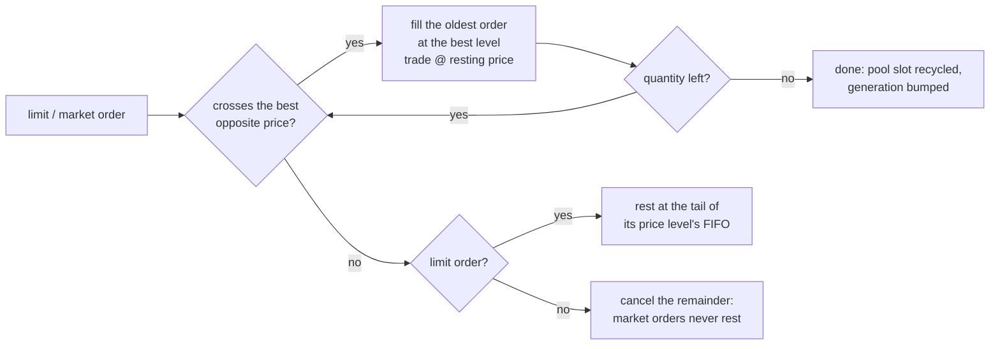

# kicks: a sneaker resale exchange in C++20

`kicks` simulates a sneaker resale market (think StockX/GOAT) from the matching engine up.
Every SKU has its own **price-time priority limit order book** that handles ~25 M orders/s. A floor
of **agent-based traders** (collectors, resellers, hypebeasts and market makers) works those books,
reacting to a mean-reverting **hype process**, random news and drops. The results come out as
terminal charts: ASCII candlesticks with volume, a depth ladder and a live ticker. Money is
integer cents, all randomness is seeded, and there are no dependencies beyond the standard library
and the shared `core` module.

```
── MARKET BOARD  ·  day 60 ──────────────────────────────────────────────────────────────────
  SKU       SNEAKER        RETAIL    LAST     1D      7D  PREMIUM  30D              HYPE
  ────────────────────────────────────────────────────────────────────────────────────────────
  AJ1-CHI   Chicago          $160  $1,544   0.0%  +16.8%    +865%  ▃▄▄▃█▇▅▄▄▄▂▁▃▃▅  █████▊ 95
  KB6-GRN   Grinch           $180    $649  +1.4%   +5.0%    +261%  █▆▄▂▁▆█▅▃▃▃▃▄▄▃  ████▎  70
  AJ11-CON  Concord          $220    $459  -0.9%  -12.4%    +109%  ▆█▇▇▅▅▅▄▄▄▇▅▁▂▄  ███▍   57
  AZG-WHT   White/Crimson    $110    $198   0.0%  +17.9%     +80%  ▂▂▆▃▁▂▂▂█▄▄▃▃██  ███▏   51
  SSTR-WB   White/Black      $100     $76  -7.3%   +4.1%     -24%  ▆▅▄▂▁▁▁▁▄▄▄███▇  ▌       9

AJ11-CON  Air Jordan 11 Retro "Concord"  ·  retail $220
open $471  high $599  low $378  close $459  -2.5% over 60 days  ·  1,545 pairs traded
$544 ┤┃         ╷   ╷            ╷│  ┃┃┃  ╽┃          ╷ ╽╽╷      │
     │┃         │   │          ╷ ││  ┃╹┃ ╽╿┃          │ ┃┃╽      │
     │┃┃  │     │   │          │ ┃╿│ ┃ ╿┃┃│┃  ╻ ╷     │ ┃┃┃      │
$496 ┤┃┃│╷┃     │   │          │╻┃│┃ ┃  │┃ ╵╽╽┃╽┃│┃  ╽┃╽┃┃┃╷     │
     │┃┃╽┃┃     │   │         ╻┃┃┃╵┃╻╿  │   ╿╿│╿┃╽┃╽ ┃┃┃┃ ╹╽     │
     │╿╿╵╹╹╻│  ╻┃┃  │   ╷     ┃┃╿   ┃│  │   ╵│  ╹┃┃│ ┃┃┃╵  ┃╷   ╻╽ ◄ $459
$449 ┤╵│   ╿┃╽ ┃╵┃ ╷│  ╻│ ┃╹  ┃││   ╵   ╵    ╵      ┃╵││   ┃│   ╿┃
     │     ╵│╹╻┃ ┃ ╽╽╻╻╿╿╷┃ ╷ ┃│                    ╿ ╵╵   ┃╽╷╽┃│
     │        ┃┃ ╿╷┃┃┃╿  ┃┃ ┃╽┃│                    │       ╿┃┃┃
 vol │██▇▄▅█▇▁█▇███▇██▄▅▃▄▄▁▅▆▇█▄▄▇▄▆█▆▄█▄▅▅▃▄▄▃▄▃▄▃████▇▆▂██▅▅▂▆█
     └┬────────┬─────────┬─────────┬─────────┬─────────┬─────────┬
      d1       d10       d20       d30       d40       d50       d60
```
<sub>Excerpt of `street market --seed 7 --sku AJ11-CON --no-color`. In a terminal, up candles are green and down candles red.</sub>

---

## The order book

`OrderBook` (`order_book.hpp`) is a single-instrument limit order book. It supports limit and
market orders, partial fills, O(1) cancels, L2 depth and a shared sequence number for events.

**Matching rules.** An incoming order trades against the opposite side while prices cross: best
price first, and oldest first within a price (**price-time priority**). Every fill prints at the
**resting order's price**, so the aggressor keeps any price improvement. What a limit order does
not fill rests on the book. What a market order does not fill is cancelled, because market orders
never rest. Accepted orders and trades take their numbers from one monotonically increasing
sequence, so every book event has a total order.



**Data layout.** The book is designed so that, once warm, it runs without touching the allocator:

| Structure | What it is | Why |
|---|---|---|
| Order pool | `std::vector<Node>` plus a free list; FIFO queues are linked by 32-bit indices | resting an order never allocates, and nodes stay dense in memory |
| `OrderId` | generational handle: `generation << 32 \| slot` | lookup is a bounds check plus one compare. No hash map is needed, and stale ids (filled or cancelled) fail because their slot's generation has moved on |
| Price ladder | one sorted `std::vector<{key, level}>` per side, best price at the **back** (`key = +price` for bids, `-price` for asks) | nearly all activity happens at the touch, so matching pops from the back and inserts/erases shift only a few entries. This is much friendlier to the cache than a node-based `std::map` |
| Level pool | stable slots holding `{price, total qty, order count, head, tail}` | a cancel updates its level in O(1) through the order's level slot |

| Operation | Cost | Notes |
|---|---|---|
| `limit` joining the best level or setting a new best price | O(1) | fast paths before any search |
| `limit` at another existing level | O(log L) | binary search over the side's contiguous ladder |
| `limit` opening a new inner level | O(log L + k) | k = levels between that price and the far end, usually a handful |
| each fill while matching | O(1) | pops the level's FIFO head; an emptied level is `pop_back`ed |
| `cancel` | **O(1)** | id → slot → unlink. Only a cancel that empties a level touches the ladder |
| `best_bid` / `best_ask` / `spread` | O(1) | back of the ladder |
| `depth(side, n)` | O(n) | walks the ladder from the back |

**Why integer cents?** `Price` is `std::int64_t` cents. Levels compare exactly, there is no
rounding drift across millions of fills, and notional sums are exact. Floating point never enters
the matching engine. It appears only in the simulation layer (fair values), and prices are
snapped to the $1 grid before they reach a book.

### Benchmark

`benchmark(orders, seed)` replays a synthetic flow that is pre-generated from the seed, so
generation cost stays out of the timings:

- 45% passive limits, a geometric number of cents behind a wandering, mean-reverting mid
- 10% marketable limits
- 5% market orders
- 40% cancels aimed at the last 4,096 limit orders (some are already filled, as on real venues)

The flow is replayed twice on fresh books. The first pass is timed as a whole for throughput. The
second pass timestamps every operation for the latency distribution. On x86 those timestamps come
from `rdtsc`, calibrated against `steady_clock` for the whole pass, with the measured timer
overhead subtracted. This is needed because MSVC's `steady_clock` (QueryPerformanceCounter) ticks
every 100 ns.

`street market --bench` (1,000,000 operations, seed 1), laptop with a Ryzen 7 5825U, 3 runs each:

| Compiler | Throughput | p50 | p99 | p99.9 |
|---|---|---|---|---|
| MSVC 19.44 `/O2` (Windows 11) | 25.0 – 27.4 M orders/s | 20 ns | 110 – 130 ns | 250 – 261 ns |
| GCC 15.2 `-O3` (WSL2 Ubuntu) | 23.6 – 28.9 M orders/s | 20 – 30 ns | 100 – 120 ns | 251 – 381 ns |

On AMD Zen the TSC advances in ~10 ns steps, so latencies are quantised to about 10 ns. The book
ends each run with about 34k resting orders, the stale liquidity that real books accumulate too.

```
╭─ MATCHING ENGINE BENCHMARK ──────────────────────────────────╮
│ orders        1,000,000   limit 55% · market 5% · cancel 40% │
│ trades        462,450                                        │
│ elapsed       41.4 ms                                        │
│ throughput    24.16 M orders/s                               │
│ latency p50      20 ns  █▍                                   │
│         p99     120 ns  ████████▌                            │
│         p99.9   341 ns  ████████████████████████             │
│ book at end   33,698 resting orders                          │
╰──────────────────────────────────────────────────────────────╯
```

---

## The market model

`Market` (`market.hpp`) lists every catalog sneaker as an already-released shoe with an open
secondary market. `step_day()` runs 240 trading rounds (ticks). In each tick, every SKU updates
its hype, its market maker requotes if needed, and a Poisson number of traders arrive and act.
The day then closes one OHLCV candle per SKU. A full 60-day run of the 16-SKU catalog takes about
50 ms.

| Persona | Count | Playbook |
|---|---|---|
| Collector | 70 | Values a pair at anchor × √(hype multiplier) × a personal taste factor, so they only half-believe the hype. Lifts asks at or below that value, otherwise works patient bids 3–12% under it. Sells into bids 15%+ above value, so hype spikes pull pairs out of collections and dips bring collectors in as buyers. Also rotates the odd duplicate out |
| Reseller | 50 | Wins raffles (4 tickets each, for the bots). Lists at a 10–35% markup over cost and the street price, and cuts the ask 4–7% each time it sits unsold past their patience, never below a floor. Dumps into the bid when a pair is long stale. Flips underpriced asks |
| Hypebeast | 80 | Rides *heat* = 6 × momentum (20-tick vs 1-day EMA of price) + headline buzz. Pays up to fair value × (1.03 + 0.3 × heat) when it runs hot, dumps when heat turns negative, and banks flips |
| Market maker | 1 per SKU | Quotes 3 pairs a side at fair value ± 2%, shading both quotes against inventory (long means quote lower). Requotes when a side is filled, when fair value moves 0.6%, or on a timer |

**Fair value and hype.** Each SKU carries a log-deviation `X` from its long-run fair value
`anchor = retail × resale_multiplier(base_hype)`. `X` follows an Ornstein–Uhlenbeck process that
is sampled exactly (no discretisation bias):

```
dX = −θ·X dt + σ dW,     θ = ln 2 / half-life (8 days),   σ = 0.03 + 0.04 · base_hype  per √day
X(t+Δ) = X(t)·e^(−θΔ) + σ·√((1 − e^(−2θΔ)) / 2θ) · N(0,1)
fair value = anchor · e^X          hype index = logistic(logit(base_hype) + X) ∈ (0, 1)
```

- **Shocks.** `shock(sku, m, headline)` applies `X += log(1 + m)`, so fair value jumps by exactly
  `m` (for example +25%) and then decays with the half-life. The shock also adds buzz, which
  brings in hypebeasts. The move shows up in prices within the day because makers requote around
  the new fair value.
- **News.** Every morning, each SKU may draw a headline: a celebrity or rapper sighting, a music
  video, a collab teaser, "sold out in seconds", an auction record, a restock rumour, a confirmed
  retro, a flood of fakes. Each headline carries a sampled impact. Hot shoes get more press.
  `render_news` shows the biggest ones next to the price reaction that followed.
- **Drops.** `release(sneaker)` raffles the pairs at retail. Resellers enter with 4 tickets,
  hypebeasts with 2 and collectors with 1, with a limit of 2 pairs per person. The maker takes a
  consignment allocation, and the secondary market opens with +20% launch buzz.
- **Accounting.** A resting ask reserves pairs and a resting bid reserves cash. Fills release
  exactly what they consumed, because trades print at the maker's price. Nobody can sell pairs they
  don't own. Trading conserves pairs and cash (tested), and `persona_stats()` marks every
  persona's P&L to market. In practice hypebeasts overpay and market makers earn the spread.
- **Determinism.** The same seed and the same calls produce the same history, and MSVC and GCC
  runs produce identical output. Each SKU draws its fundamentals (hype noise, news) and its order
  flow from separate PCG32 streams. As a result, a shock to one SKU leaves every other SKU's hype
  path untouched, which keeps "shocked vs control" comparisons clean.

---

## Rendering

All renderers are pure functions that return `std::string`. With colours off (`--no-color`,
`NO_COLOR`, or piped output) they produce the same aligned text without escape codes. The tests
check that `strip_ansi(coloured) == plain`.

- **`render_candles`** draws one column per candle at half-row vertical resolution. Box-drawing
  half strokes encode *(upper half, lower half)* of each cell as empty / wick / body, and each
  cell uses one of nine glyphs: ` ╷╻ ╵│╽ ╹╿┃`. Heavy strokes are bodies and light strokes are
  wicks. Up candles are green and down candles red. The chart has a labelled price axis, a
  `◄ last` marker, eighth-block volume bars and a collision-free day axis.
- **`render_depth`** shows asks (red) above the spread line (spread, spread %, mid) and bids
  (green) below, with 1/8-block bars proportional to the size resting at each level.
- **`render_ticker`** is a borderless board with SKU, colorway, retail, last, 1D/7D, premium over
  retail, a 30-day sparkline and a hype meter shaded from cold cyan to hot red. It fits in 100
  columns.
- `render_news`, `render_floor` (persona P&L), `render_catalog`, `render_bench`, and `ascii_sneaker()`
  (a high-top in plain ASCII in "Chicago" colours).

---

## The catalog

Sixteen silhouettes, including the signature shoes of Michael Jordan, Kobe Bryant, LeBron
James and Allen Iverson. Each entry carries a one-line `story`, and `street market --catalog`
prints those stories under the table.

| SKU | Sneaker | Year | Retail | Pairs (est.) | Base hype | Long-run resale | Story |
|---|---|---|---|---|---|---|---|
| AJ1-CHI | Air Jordan 1 High OG "Chicago" | 2015 | $160 | 80K | 0.95 | ~$1,474 | Jordan's first signature shoe; the Chicago colorway debuted in 1985 |
| AJ1-BAN | Air Jordan 1 High OG "Banned" | 2016 | $160 | 110K | 0.78 | ~$778 | Star of Nike's 1985 "Banned" ad campaign |
| KB6-GRN | Nike Kobe 6 Protro "Grinch" | 2020 | $180 | 150K | 0.72 | ~$691 | Kobe Bryant wore the "Grinch" on Christmas Day 2010 |
| AJ3-BLC | Air Jordan 3 Retro "Black Cement" | 2018 | $200 | 250K | 0.52 | ~$357 | The AJ3 of Jordan's free-throw-line win at the 1988 Slam Dunk Contest |
| AJ4-BRD | Air Jordan 4 Retro "Bred" | 2019 | $200 | 700K | 0.62 | ~$518 | Worn by Jordan for "The Shot" over Craig Ehlo, 1989 playoffs |
| AJ5-FRD | Air Jordan 5 Retro "Fire Red" | 2020 | $200 | 400K | 0.40 | ~$244 | Jordan scored his career-high 69 points in the AJ5 (1990) |
| AJ6-INF | Air Jordan 6 Retro "Infrared" | 2019 | $200 | 300K | 0.42 | ~$258 | The shoe of Jordan's first NBA title, 1991 |
| AJ11-CON | Air Jordan 11 Retro "Concord" | 2018 | $220 | 800K | 0.55 | ~$437 | Worn by Jordan through the Bulls' record 72-10 season, 1995-96 |
| AJ12-FLU | Air Jordan 12 Retro "Flu Game" | 2016 | $190 | 350K | 0.45 | ~$268 | Worn by Jordan in the 1997 "Flu Game", Game 5 of the Finals |
| AJ13-HGG | Air Jordan 13 Retro "He Got Game" | 2018 | $190 | 250K | 0.35 | ~$206 | Named for Spike Lee's 1998 film "He Got Game", starring Ray Allen |
| FOAM-RYL | Air Foamposite One "Royal" | 2011 | $220 | 40K | 0.52 | ~$392 | Made famous by Penny Hardaway in 1997 |
| AZG-WHT | Air Zoom Generation "White/Crimson" | 2003 | $110 | 200K | 0.50 | ~$183 | LeBron James's first signature shoe, launched for his 2003 rookie season |
| QSTN-RED | Reebok Question Mid "Red Toe" | 2016 | $150 | 60K | 0.28 | ~$142 | Allen Iverson's first signature shoe (1996), worn in his Rookie of the Year season |
| DUNK-PND | Nike Dunk Low "Panda" | 2021 | $100 | 2M | 0.38 | ~$116 | A 1985 college basketball shoe, now an everyday best-seller |
| AF1-WHT | Nike Air Force 1 '07 "Triple White" | 2007 | $115 | 10M | 0.12 | ~$94 | Bruce Kilgore's 1982 design, Nike's first basketball shoe with Air |
| SSTR-WB | adidas Superstar "White/Black" | 1969 | $100 | 5M | 0.10 | ~$81 | Immortalised by Run-DMC's "My Adidas" (1986) |

Retail prices are retro MSRPs. Pair counts are rough public estimates (brands do not publish
them) and only set how many pairs float on the simulated market (∝ √pairs, clamped to 40–180).
`resale_multiplier(h) = 0.8 + 1.2h² + 9h⁴` is convex on purpose: general releases trade a little
under retail, mid-tier retros at 1.2–2.5×, and grails at 8–10×.

---

## API

```cpp
#include "street/kicks/kicks.hpp"
using namespace street::kicks;

// The matching engine on its own.
OrderBook book;
const OrderResult ask = book.limit(/*trader=*/1, Side::Sell, dollars(200), 2);
const OrderResult buy = book.market(/*trader=*/2, Side::Buy, 1); // 1 pair @ $200.00
book.cancel(ask.id);                                             // pulls the last pair
// book.best_bid(), book.best_ask(), book.depth(Side::Buy, 10), book.order(id), ...

// The market, as the culture layer drives it.
Market market(classic_catalog(), /*seed=*/7);
market.release({"ST-SIG1", "Street Signature 1", "Home", 2026, dollars(180), 30'000, 0.6,
                "A fictional star's first signature shoe"});
market.run(5);
market.shock("ST-SIG1", +0.25, "50-point triple-double on opening week");
market.step_day();

std::cout << render_ticker(market)
          << render_candles(market.candles("ST-SIG1"), {.width = 60, .height = 12, .title = "ST-SIG1"})
          << render_depth(market.book("ST-SIG1"), 8)
          << render_news(market, 5);

const BenchResult r = benchmark(1'000'000, /*seed=*/1); // r.orders_per_second, r.p50_ns, r.p99_ns
```

Per-SKU queries (`sneaker`, `candles`, `last_price`, `fair_value`, `hype`, `book`, `supply`,
`recent_trades`) match SKUs case-insensitively. They throw `std::out_of_range` for unknown SKUs.

## CLI

```
street market [--days N] [--sku SKU] [--seed N] [--catalog] [--depth] [--bench [N]]

street market                                   # 60 days of the classic catalog, random seed
street market --seed 7 --sku AJ11-CON --depth   # feature the Concord 11, show its order book
street market --days 250 --no-color > run.txt   # a year of trading as plain text
street market --catalog                         # the sneakers on the exchange
street market --bench                           # 1,000,000-order benchmark (--bench N for N)
```

The command prints a header with the ASCII sneaker, the market board, a candlestick chart of the
featured SKU (the biggest mover unless `--sku` is given), the headlines that moved prices, the
floor's P&L by persona, and optionally the depth ladder. It always prints the seed and a replay
command line.

## Tests

`street_kicks_tests`: 34 doctest cases, about 0.4 s in Release. They pass on MSVC and on GCC,
including under ASan/UBSan.

- **Order book:** FIFO within a level, price before time, execution at the resting price,
  partial fills both ways, market orders sweeping several levels, market orders against an empty
  side, exact cancels (live once; never filled, unknown or recycled ids), shared sequence numbers
  and input validation. A 20,000-operation randomised property test checks that the book is never
  crossed after matching, that `filled + resting + cancelled == submitted` holds for every order,
  that bought equals sold, and that depth agrees with the individual orders.
- **Market:** determinism (same seed gives identical candles and news, a different seed diverges),
  well-formed candles, plausible premiums (grails far above retail, GRs near it, prices tracking
  fair value), a shock lifting prices within 3 days against a control run (and a negative shock
  lowering them), conservation of pairs and cash, drops and raffles, news logging, and error
  handling.
- **Hype:** exact half-life decay with the noise off, shock size, and the index staying bounded.
- **Rendering:** chart axes, glyphs, windowing, the last-price marker and colour/plain parity. Also
  ladder ordering and spread/mid, ticker coverage within 100 columns, the news/floor/catalog
  widths, and an ASCII-only sneaker.
- **Benchmark:** mix accounting, determinism of the matching results, and ordered percentiles.

## Files

| File | Responsibility |
|---|---|
| `include/street/kicks/types.hpp` | `Price`, `OrderId`, `Side`, `Trade`, `Level` |
| `include/street/kicks/order_book.hpp` · `src/order_book.cpp` | the matching engine |
| `include/street/kicks/catalog.hpp` · `src/catalog.cpp` | `Sneaker` (with its `story`), `classic_catalog()`, `resale_multiplier()` |
| `include/street/kicks/hype.hpp` · `src/hype.cpp` | exact Ornstein–Uhlenbeck hype process |
| `include/street/kicks/market.hpp` · `src/market.cpp` | `Market`: listings, days, drops, shocks, queries |
| `src/floor.hpp` · `src/floor.cpp` | traders, listings, reservations and trade settlement |
| `src/agents.hpp` · `src/agents.cpp` | persona behaviours and the market maker |
| `src/news.hpp` · `src/news.cpp` | procedural headlines with impacts |
| `include/street/kicks/render.hpp` · `src/render_candles.cpp` | candlestick chart |
| `src/render_depth.cpp` | depth ladder |
| `src/render_board.cpp` | ticker, news, floor P&L, catalog |
| `src/sneaker_art.cpp` | `ascii_sneaker()` |
| `src/format.hpp` · `src/format.cpp` | shared price/percent formatting and palette |
| `include/street/kicks/bench.hpp` · `src/benchmark.cpp` | flow generator, two-pass benchmark, results panel |
| `src/cycle_clock.hpp` | calibrated `rdtsc` timestamps with a `steady_clock` fallback |
| `include/street/kicks/kicks.hpp` | umbrella header |
| `tests/test_order_book.cpp`, `tests/test_market.cpp`, `tests/test_render.cpp` | doctest suites |
